# Job lifecycle: states, transitions, and events

- [Job lifecycle: states, transitions, and events](#job-lifecycle-states-transitions-and-events)
  - [Topology](#topology)
  - [Components](#components)
  - [Delivery and retries](#delivery-and-retries)
  - [State machines](#state-machines)
    - [Job state](#job-state)
    - [Run state](#run-state)
  - [Event vocabulary](#event-vocabulary)
  - [Job succeeded](#job-succeeded)
  - [Job failed](#job-failed)
    - [Path A: pod reaches terminal phase](#path-a-pod-reaches-terminal-phase)
    - [Path B: executor's issue handler detects a problem first](#path-b-executors-issue-handler-detects-a-problem-first)
    - [Other failure sources](#other-failure-sources)
  - [Job preempted](#job-preempted)
    - [Scheduler-initiated preemption](#scheduler-initiated-preemption)
    - [API and control-plane preemption](#api-and-control-plane-preemption)
    - [Run reconciliation](#run-reconciliation)
  - [Job cancelled](#job-cancelled)
    - [Job-set and control-plane cancellation](#job-set-and-control-plane-cancellation)
  - [Lease return and requeue](#lease-return-and-requeue)
  - [Lease expiry](#lease-expiry)
  - [Job rejected](#job-rejected)

Events drive the job and run lifecycle in Armada. This doc describes the architecture, the state machines, the events, and the flows that end or requeue a job.

For scheduling and preemption mechanics, see [scheduling_and_preempting_jobs.md](../scheduling_and_preempting_jobs.md).

## Topology

Armada is a multi-cluster system. One control plane runs centrally. Each worker Kubernetes cluster runs one executor.

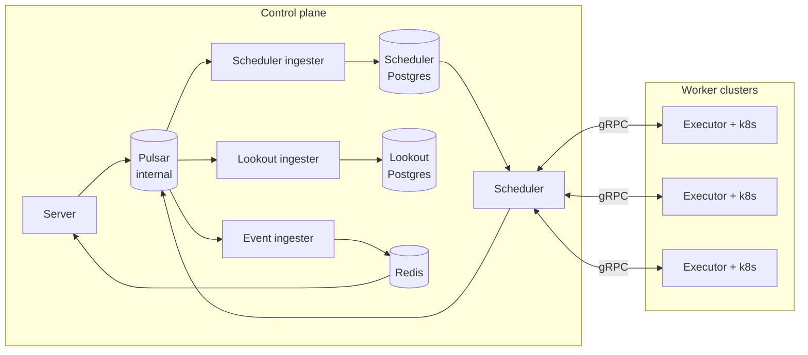

Pulsar is the internal event bus of the control plane. The server and the scheduler publish to Pulsar, and the ingesters consume from it. The scheduler reads the scheduler Postgres database, which the scheduler ingester writes.

Executors reach the control plane through the `ExecutorApi` gRPC service, which the scheduler serves:

- **`LeaseJobRuns`** is a bidirectional stream. The executor sends one `LeaseRequest` with its state and capacity. The scheduler replies with new leases, cancel-runs instructions, and an end marker, and then ends the stream. The executor opens a new stream on the next lease cycle.
- **`ReportEvents`** is a unary call. The executor sends batches of run-level event sequences. The scheduler authorises the caller and publishes the events to Pulsar.

## Components

A run is one attempt to start the pod. A job has a maximum of one active run at a time.

- **Server.** Accepts job submissions and requests over its gRPC API. It validates the requests and publishes the related events to Pulsar.
- **Scheduler.** Makes the scheduling decisions. Only the leader makes decisions. It keeps an in-memory `jobdb`, reconciles it with Postgres on each cycle, and publishes its decision events.
- **Scheduler ingester.** Writes events to the scheduler Postgres database. This database is canonical, and the `jobdb` is a cached view of it.
- **Lookout ingester.** Writes events to the Lookout Postgres database, which drives the Lookout UI.
- **Event ingester.** Writes events to Redis, which backs the external event-stream API. It keeps `JobRunErrors` only for the `LeaseExpired` and `PodLeaseReturned` reasons. It removes `JobRunSucceeded`, `JobValidated`, and `JobRunTerminatedDebugInfo`. It also clears cancel reasons, start-up info, and debug messages.
- **Executor.** Creates and watches pods through the local Kubernetes API, and reports run events. The state reporter reports pod phases. The issue handler reports pods that fail or disappear.

Before the executor deletes a pod, it writes the `deletion_requested` annotation (`domain.MarkedForDeletion`). The informer update path of the state reporter skips phase reports for annotated pods. This prevents a second terminal event for a pod that the executor deletes. Only the informer update path checks this annotation.

## Delivery and retries

**Executor reports.** The state reporter queues events in a buffer with 1,000,000 slots. The buffer drains every two seconds, or earlier when a batch is full. The event sender compacts each batch and splits it by message size. On failure, the per-event callbacks receive the error. The issue handler and the submission paths call `Report` directly.

Two mechanisms retry a failed report:

- The reconciliation pass of the state reporter sends the event again. It selects pods with an unreported phase, at least 30 seconds in that phase, and no queued events. It skips the Pending phase, so `JobRunAssigned` has no retry.
- The issue handler sets an in-process `Reported` marker after a successful `Report` call. The next handler tick retries a failed call. The executor loses this marker on restart.

**Heartbeat.** Each new `LeaseJobRuns` stream is a heartbeat. The scheduler records the last heartbeat of each executor, and it uses this time to detect [lease expiry](#lease-expiry).

**Pulsar redelivery.** Postgres writes are effectively idempotent. `MarkRunsSucceeded`, `MarkRunsFailed`, and `MarkRunsPreempted` take their timestamps from the `Created` field of the event, and a redelivered event has the same value. The scheduler ingester upserts `job_run_errors` on `run_id`.

The event ingester adds to the Redis stream with an automatic ID, so a redelivery adds a second entry. API watchers can see the same external event twice. The scheduler also generates its events again after a publish failure, with a new `Created` value.

## State machines

Armada shows state per job and per run. The public names are the Lookout enums in `internal/common/database/lookout/jobstates.go`. The diagrams below show these Lookout states.

The scheduler tracks boolean flags (`queued`, `failed`, `succeeded`, `cancelled`, and `validated`). Its mutually exclusive states are Queued, Running, Cancelled, Failed, and Succeeded. Its `Running` state includes the Lookout states `Leased`, `Pending`, and `Running`. Lookout derives `Preempted` and `Rejected` from the reason in a `JobErrors` event.

Lookout guards the job state. It drops updates to a terminal job, but `Preempted` can replace `Succeeded`, `Failed`, or `Cancelled`.

Lookout does not guard run rows. Each event overwrites the columns that it sets, so a late event can change a terminal run state. A run can show `RUN_FAILED` under a `PREEMPTED` job.

The executor reports only the current phase of a pod, so a run can skip `Pending` or `Running`. `Leased` to `Running` occurs when `JobRunAssigned` is missing.

### Job state

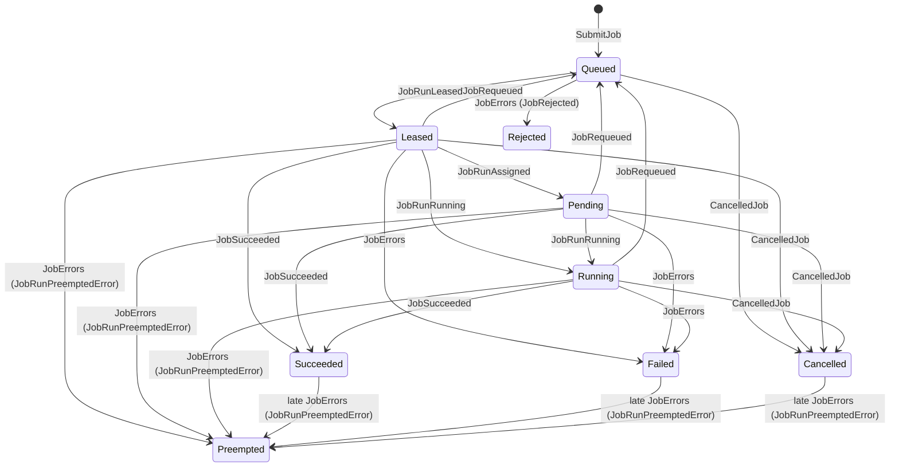

### Run state

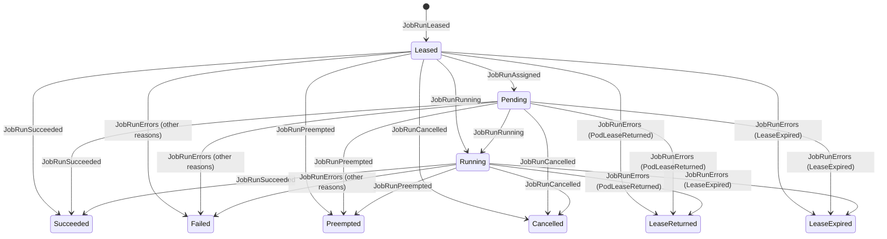

A run returns its lease from `Leased` when pod creation fails with a recoverable error. It returns its lease from `Running` when a pod with started containers matches a configured failed-container check.

## Event vocabulary

**Request events** ask for a change. The scheduler ingester writes them to Postgres, and the scheduler acts on a later cycle.

| Event                    | Emitted by          | Carries                 |
| ------------------------ | ------------------- | ----------------------- |
| `SubmitJob`              | server              | job spec                |
| `CancelJob`              | server or scheduler | job ID, optional reason |
| `CancelJobSet`           | server              | job states, reason      |
| `JobPreemptionRequested` | server              | job ID, reason          |
| `ReprioritiseJob`        | server              | job ID, priority        |
| `ReprioritiseJobSet`     | server              | priority                |

**Run-level events** describe what happened to one run.

| Event                       | Emitted by            | Carries                                                                              |
| --------------------------- | --------------------- | ------------------------------------------------------------------------------------ |
| `JobRunLeased`              | scheduler             | executor ID, node ID, pool, scheduling priority                                      |
| `JobRunAssigned`            | executor              | pod identity, pod number, pool                                                       |
| `JobRunRunning`             | executor              | pod identity, node name, pod number, pool, start-up info                             |
| `JobRunSucceeded`           | executor              | pod identity, node name, pod number                                                  |
| `JobRunErrors`              | executor or scheduler | one or more `Error` values                                                           |
| `JobRunPreempted`           | scheduler             | preempted run ID, preempted job ID, preempting job ID, reason, requestor             |
| `JobRunCancelled`           | scheduler             | run ID, job ID, cancel reason, requestor                                             |
| `JobRunTerminatedDebugInfo` | executor              | run ID, job ID, debug message (diagnostic only)                                      |
| `StandaloneIngressInfo`     | executor              | pod identity, ingress addresses                                                      |
| `ResourceUtilisation`       | executor              | pod identity, resource usage                                                         |

**Job-level events** come from the scheduler. A job outcome usually follows one scheduler cycle after the run-level event reaches the database. The scheduler generates these events on every cycle.

| Event              | Emitted by | Carries                                                       |
| ------------------ | ---------- | ------------------------------------------------------------- |
| `JobSucceeded`     | scheduler  | job ID                                                        |
| `JobErrors`        | scheduler  | one or more `Error` values                                    |
| `CancelledJob`     | scheduler  | job ID, cancel user                                           |
| `JobRequeued`      | scheduler  | job ID, updated scheduling info, queued version               |
| `JobValidated`     | scheduler  | job ID, pools                                                 |
| `ReprioritisedJob` | scheduler  | job ID, priority, requestor                                   |

**`Error` values** have these fields:

- `terminal`: true when Armada stops work on the run or the job.
- `reason`: one of `PodError`, `PodLeaseReturned`, `LeaseExpired`, `MaxRunsExceeded`, `JobRunPreemptedError`, `JobRejected`, or `ReconciliationError`.
- `failure_category` and `failure_subcategory`: the classification of the failure.
- `retry_policy_name`: the policy that decided a retry.

Preemption errors use the category `preemption`. The subcategory is the preemption type: `fairshare`, `urgency`, `optimiser`, `api`, `reconciler`, `unknown`, or `unknown-gang`.

**External API events** are what watchers of the event-stream API see. The conversion layer makes them from the events in Redis.

| Internal event                   | External event                                    | Notes                                                       |
| -------------------------------- | ------------------------------------------------- | ----------------------------------------------------------- |
| `SubmitJob`                      | `JobSubmittedEvent` and `JobQueuedEvent`          |                                                             |
| `JobRunLeased`                   | `JobLeasedEvent`                                  |                                                             |
| `JobRunAssigned`                 | `JobPendingEvent`                                 |                                                             |
| `JobRunRunning`                  | `JobRunningEvent`                                 |                                                             |
| `JobSucceeded`                   | `JobSucceededEvent`                               |                                                             |
| `JobErrors`                      | `JobFailedEvent`                                  | Carries the reason and the category. `Retryable` is true for a non-terminal error. |
| `CancelJob`                      | `JobCancellingEvent`                              |                                                             |
| `CancelledJob`                   | `JobCancelledEvent`                               |                                                             |
| `JobPreemptionRequested`         | `JobPreemptingEvent`                              |                                                             |
| `JobRunPreempted`                | `JobPreemptedEvent`                               |                                                             |
| `ReprioritiseJob`                | `JobReprioritizingEvent`                          |                                                             |
| `ReprioritisedJob`               | `JobReprioritizedEvent`                           |                                                             |
| `ResourceUtilisation`            | `JobUtilisationEvent`                             |                                                             |
| `StandaloneIngressInfo`          | `JobIngressInfoEvent`                             |                                                             |
| `JobRunErrors`                   | `JobLeaseReturnedEvent` or `JobLeaseExpiredEvent` | For the `PodLeaseReturned` and `LeaseExpired` reasons only. |
| `JobRunSucceeded`                | (none)                                            | Watchers use `JobSucceededEvent`.                           |
| `JobRunCancelled`                | (none)                                            | Watchers use `JobCancelledEvent`.                           |
| `JobRequeued`                    | (none)                                            | Watchers see the next `JobLeasedEvent`.                     |
| `CancelJobSet`                   | (none)                                            | Watchers see one `JobCancellingEvent` per job.              |
| `JobRunTerminatedDebugInfo`      | (none)                                            | Only Lookout stores this event.                             |
| `JobValidated`                   | (none)                                            |                                                             |
| `ReprioritiseJobSet`             | (none)                                            |                                                             |

Watchers see the outcome of a job when the scheduler emits the job-level event. Lookout updates the run state from the run-level event, and the job state from the job-level event.

The scheduler publisher also emits `PartitionMarker`, which checks that the database is up to date. This event is not part of the job lifecycle.

## Job succeeded

- **Run state:** to `Succeeded`.
- **Job state:** to `Succeeded`.

Phase 1, the executor observes the pod:

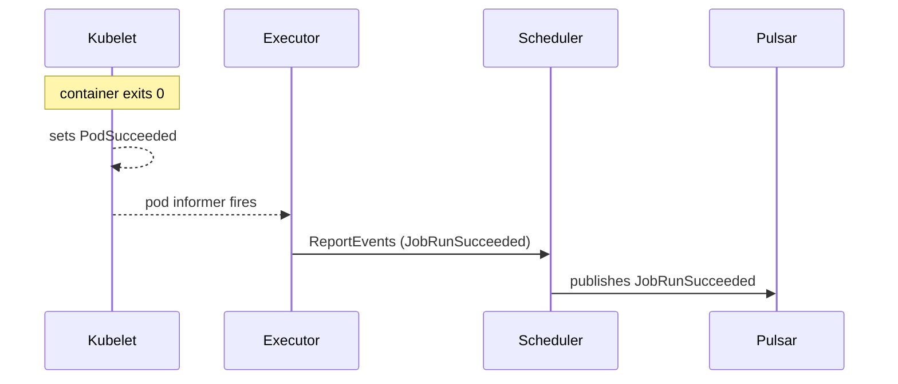

The scheduler ingester writes `runs.succeeded` and `terminated_timestamp`. The Lookout ingester writes the run state.

Phase 2, the scheduler concludes the job:

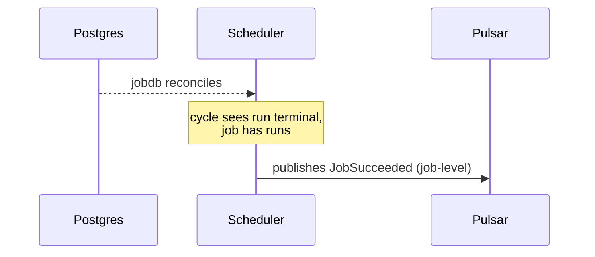

The scheduler ingester writes `jobs.succeeded`, and the Lookout ingester writes the job state. Watchers receive `JobSucceededEvent`.

## Job failed

### Path A: pod reaches terminal phase

- **Run state:** to `Failed`. A pod that exits quickly can go from `Pending` to `Failed`.
- **Job state:** to `Failed`, or back to `Queued` when a retry policy grants a retry.

Phase 1, the executor observes the pod:

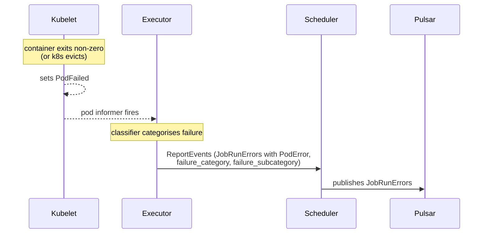

The scheduler ingester writes `runs.failed` and `terminated_timestamp`, and upserts `job_run_errors`. The Lookout ingester writes the run state.

Phase 2, the scheduler concludes the job:

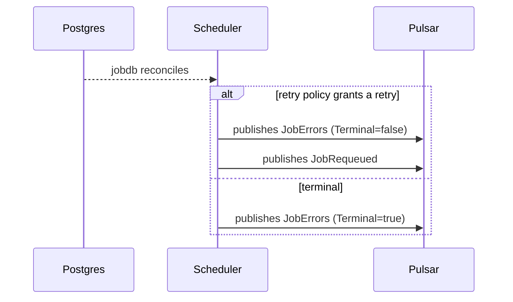

The terminal `JobErrors` copies the run error reason. When a retry policy decides the failure, the reason is `MaxRunsExceeded`. Retries apply only when `retryPolicy.enabled` is true and a policy matches. See [retry_policies.md](../retry_policies.md).

Watchers receive `JobFailedEvent`.

### Path B: executor's issue handler detects a problem first

The issue handler processes failures that the state reporter does not report alone. Detection registers an issue in memory, and a periodic tick processes it. The `podIssueType` enum has these values:

| Issue type                 | Detected when                                                 |
| -------------------------- | ------------------------------------------------------------- |
| `UnableToSchedule`         | a Pending pod has no node after a deadline                    |
| `StuckStartingUp`          | a pod check returns a retry or fail action                    |
| `StuckTerminating`         | a pod stays in deletion past `stuckTerminatingPodExpiry`      |
| `ActiveDeadlineExceeded`   | a pod outlives its active deadline                            |
| `ExternallyDeleted`        | a pod disappears without the deletion annotation              |
| `ErrorDuringIssueHandling` | a pod starts after the handler requested its deletion         |
| `FailedStartingUp`         | a failed pod matches a retryable failed-pod check             |
| `DeleteActionFailure`      | a failed pod matches a category with the `Delete` action      |

The order of report and delete depends on the issue:

- For a non-retryable issue, the handler reports `PodError` and then deletes the pod.
- For a retryable issue, the handler deletes the pod and reports `PodLeaseReturned` when the pod is gone. See [Lease return and requeue](#lease-return-and-requeue).
- For `DeleteActionFailure`, the handler reports `PodError` when the pod is gone. If the pod outlives `stuckTerminatingPodExpiry`, the handler reports an internal failure while the pod still exists.

The diagram shows the non-retryable path:

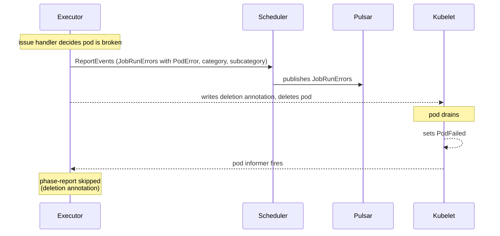

After the report, the flow continues as phase 2 of path A. The event carries the message and the category of the issue. The handler sends it at the tick, so the pod can stop later, after `terminationGracePeriodSeconds`.

### Other failure sources

| Source                      | Trigger                                                                             | Event                                                     |
| --------------------------- | ----------------------------------------------------------------------------------- | --------------------------------------------------------- |
| executor job requester      | the executor cannot build a pod from the lease                                      | `JobRunErrors` with `PodError`                            |
| executor cluster allocation | pod creation fails with a recoverable error                                         | `JobRunErrors` with `PodLeaseReturned`                    |
| executor cluster allocation | pod creation fails with a fatal error                                               | `JobRunErrors` with `PodError`                            |
| executor issue handler      | the pod of an active run stays missing past `deadlineForActivePodConsideredMissing` | `JobRunErrors` with `PodError`                            |
| scheduler                   | [lease expiry](#lease-expiry)                                                       | `JobRunErrors` and `JobErrors` in one cycle               |
| scheduler                   | [run reconciliation](#run-reconciliation) of a non-preemptible job                  | `JobRunErrors` and `JobErrors` with `ReconciliationError` |
| scheduler                   | [job rejection](#job-rejected)                                                      | `JobErrors`                                               |

If the pod of a submitted run does not appear within `deadlineForSubmittedPodConsideredMissing`, the executor removes the run from its state and emits no event. The scheduler then sends the same lease again.

## Job preempted

- **Run state:** to `Preempted`.
- **Job state:** to `Preempted`, from a `JobErrors` event with the `JobRunPreemptedError` reason.

Three mechanisms cause preemption: a scheduling decision, a request through the API or the control plane, and run reconciliation. All three emit the same three events through `createEventsForPreemptedJob`:

| Event             | Payload                                                       |
| ----------------- | ------------------------------------------------------------- |
| `JobRunPreempted` | preempted run ID, preempting job ID, reason, requestor        |
| `JobRunErrors`    | Terminal=true, `JobRunPreemptedError`, category, subcategory  |
| `JobErrors`       | Terminal=true, `JobRunPreemptedError`, category, subcategory  |

Watchers receive `JobPreemptedEvent` and `JobFailedEvent`. Lookout sets the job to `Preempted`.

### Scheduler-initiated preemption

The scheduling round decides to preempt a run and emits the events. The ingested `JobRunErrors` marks the run failed, so the generated `runs.terminated` column becomes true. On the next lease request, the scheduler tells the executor to cancel the run. The executor deletes the pod and emits no state-changing events.

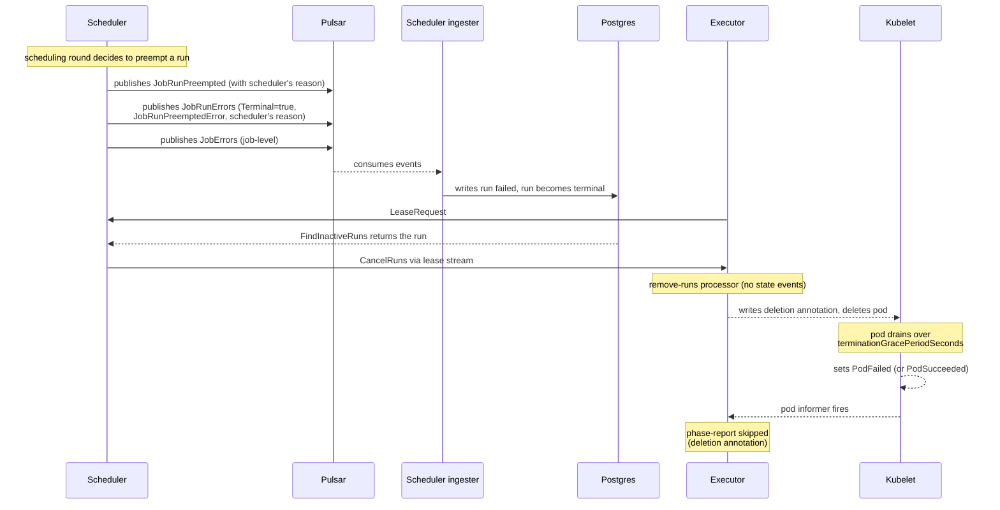

A pod can end before the executor writes the deletion annotation. The executor then reports a normal `JobRunSucceeded` or `JobRunErrors`, which overwrites the run row in Lookout. The job stays `Preempted`.

### API and control-plane preemption

A user requests preemption through `PreemptJobs`. An operator requests it for an executor, a node, or a queue through a control-plane event. Both set `preempt_requested` on the non-terminal runs of the job.

The request takes effect only for a preemptible job with an active run. The scheduler emits the events on the next cycle, with the `api` type. The teardown then follows [scheduler-initiated preemption](#scheduler-initiated-preemption).

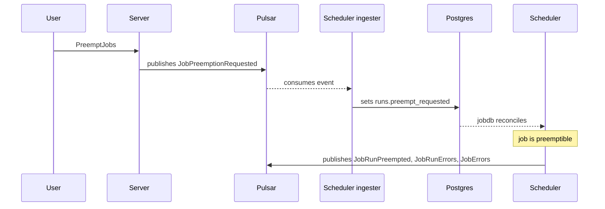

`JobPreemptionRequested` gives watchers `JobPreemptingEvent` when the server publishes the request.

### Run reconciliation

The experimental per-pool `ExperimentalRunReconciliation` setting enables this mechanism. In a scheduling round, `RunNodeReconciler` marks a leased run as invalid in these cases:

- No executor reports the node of the run, and the job is in a gang.
- The pool of the node has changed.
- The job does not match the node reservation (`EnsureReservationMatch`).
- The job runs away on a node with a matching reservation (`EnsureReservationDoesNotMatch`).

For a preemptible job, the reconciler emits the preemption events, with the `reconciler` type, and also preempts the other preemptible members of the gang. For a non-preemptible job, it emits `JobRunErrors` and `JobErrors` with the `ReconciliationError` reason.

When a node is deleted, the executor also detects the missing pod and emits `JobRunErrors` with `PodError` (`ExternallyDeleted`). The outcome depends on the order:

- If this error reaches the database before the round, the job is already terminal. The reconciler skips the job, and the run ends as `Failed`.
- If the round acts first, two producers write to the same run. The later write sets the `job_run_errors` row and `runs.terminated_timestamp`. In Lookout, the later write sets the run state and the error text.

Watchers receive one `JobPreemptedEvent` in the second case.

## Job cancelled

- **Run state:** to `Cancelled`.
- **Job state:** to `Cancelled`.

| Event             | Emitted by | Payload                                                  |
| ----------------- | ---------- | -------------------------------------------------------- |
| `CancelJob`       | server     | job ID, cancel reason                                    |
| `JobRunCancelled` | scheduler  | latest run ID, job ID, cancel reason, requestor          |
| `CancelledJob`    | scheduler  | job ID, cancel user                                      |

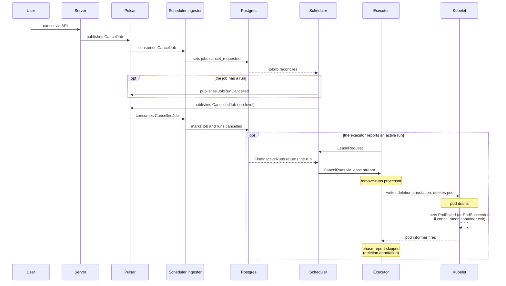

In one cycle, the scheduler checks cancel requests before run outcomes. A job with a succeeded run and a cancel request ends `Cancelled`, with no `JobSucceeded`.

`JobRunCancelled` names the latest run of the job, also when that run already ended. Lookout then changes that run to `Cancelled`. The scheduler ingester ignores `JobRunCancelled`. `MarkJobsCancelled` writes `cancelled` and `terminated_timestamp` on every run of the job, including earlier runs.

The cancel reason travels on `CancelJob`, `CancelJobSet`, and `JobRunCancelled`. Lookout stores it on the run, as the scheduler termination reason. Watchers receive `JobCancellingEvent` and `JobCancelledEvent`.

The executor emits one diagnostic `JobRunTerminatedDebugInfo` event in two cases: a cancelled pod whose main container never started, and a pod that outlives its deletion deadline. The `debugMessage` is a JSON document that describes the pod, its node, and their recent Kubernetes events. `PodError.debugMessage` uses the same format. The `application.debugEvents.enabled` setting controls this capture.

### Job-set and control-plane cancellation

`CancelJobSet` sets `cancel_by_jobset_requested` on the matching jobs. For each job, the scheduler then emits `CancelJob`, `JobRunCancelled` if the job has a run, and `CancelledJob`. The `CancelJob` gives watchers a `JobCancellingEvent` for each job.

The `CancelOnQueue`, `CancelOnExecutor`, and `CancelOnNode` control-plane events set `cancel_requested` on the matching jobs. The flow then follows [Job cancelled](#job-cancelled).

## Lease return and requeue

- **Run state:** to `LeaseReturned`.
- **Job state:** back to `Queued`, or to `Failed` if a gate stops the requeue.

An executor returns a lease when a pod cannot start, or when pod creation fails with a recoverable error. The scheduler requeues the job when all of these gates pass:

- The `armadaproject.io/failFast` annotation is not `true`.
- The attempt count is below `scheduling.maxRetries` plus 1. Only runs with `run_attempted=true` count, and `UnableToSchedule` issues do not set it.
- For an attempted run, the job still fits a node after the scheduler adds node anti-affinity for the attempted nodes.

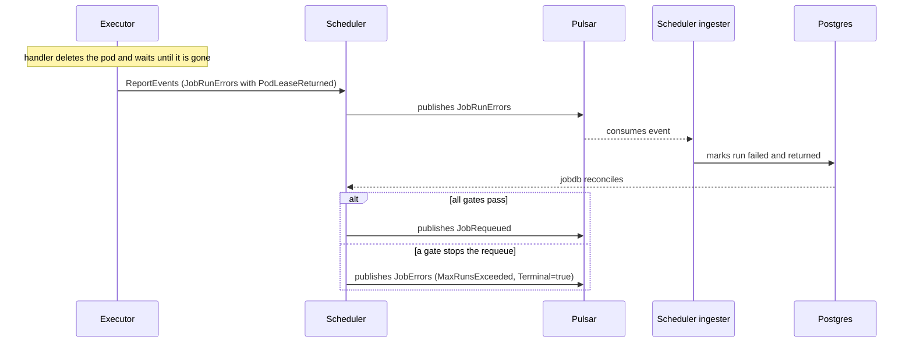

Watchers receive `JobLeaseReturnedEvent`, and then `JobLeasedEvent` for the new run or `JobFailedEvent`. Retry policies do not decide lease returns, gang jobs, or `failFast` jobs.

## Lease expiry

- **Run state:** to `LeaseExpired`.
- **Job state:** to `Failed` by default.

An executor is stale when its last heartbeat is older than `executorTimeout`. The scheduler checks on every cycle. It acts on each job that is not queued and not terminal, and whose latest run belongs to that executor. It emits the run-level and job-level events together.

| Case                  | Events                                                                       | Watchers receive                                                         |
| --------------------- | ---------------------------------------------------------------------------- | ------------------------------------------------------------------------ |
| default               | `JobRunErrors` and `JobErrors`, with `LeaseExpired`, Terminal=true           | `JobLeaseExpiredEvent`, `JobFailedEvent`                                 |
| retry policy retries  | `JobRunErrors` (`LeaseExpired`), `JobErrors` (Terminal=false), `JobRequeued` | `JobLeaseExpiredEvent`, `JobFailedEvent` (`Retryable`), `JobLeasedEvent` |
| retry policy declines | `JobRunErrors` and `JobErrors`, with `MaxRunsExceeded`, Terminal=true        | `JobFailedEvent`                                                         |

When a retry policy declines, Lookout shows the run as `Failed`. If the executor returns, the scheduler tells it to cancel the run.

## Job rejected

- **Run state:** the job has no run.
- **Job state:** `Queued` to `Rejected`.

The scheduler checks each unvalidated job on every cycle, except jobs in cordoned queues. If the job can be scheduled, the scheduler emits `JobValidated`. Otherwise, it emits `JobErrors` with the `JobRejected` reason and Terminal=true.

The scheduler ingester marks the job failed. Lookout sets the job to `Rejected` and stores the message. Watchers receive `JobFailedEvent` with the `Rejected` cause.
