# Job lifecycle: states, transitions, and events

- [Job lifecycle: states, transitions, and events](#job-lifecycle-states-transitions-and-events)
  - [Topology](#topology)
  - [Components](#components)
  - [Transport and edge cases](#transport-and-edge-cases)
  - [State machines](#state-machines)
    - [Job state](#job-state)
    - [Run state](#run-state)
  - [Event vocabulary](#event-vocabulary)
  - [Job succeeded](#job-succeeded)
  - [Job failed](#job-failed)
    - [Path A: pod reaches terminal phase](#path-a-pod-reaches-terminal-phase)
    - [Path B: executor's issue handler detects a problem first](#path-b-executors-issue-handler-detects-a-problem-first)
  - [Job preempted](#job-preempted)
    - [Scheduler-initiated preemption](#scheduler-initiated-preemption)
    - [API and control-plane preemption](#api-and-control-plane-preemption)
    - [Run reconciliation and the executor/scheduler double emission](#run-reconciliation-and-the-executorscheduler-double-emission)
  - [Job cancelled](#job-cancelled)
    - [Job-set and control-plane cancellation](#job-set-and-control-plane-cancellation)
  - [Lease return and requeue](#lease-return-and-requeue)
  - [Lease expiry](#lease-expiry)
  - [Job rejected](#job-rejected)

Events drive the job and run lifecycle in Armada. This doc covers the architecture, the state machines, the events that drive transitions, the terminal flows (succeeded, failed, preempted, cancelled, rejected), and the requeue and lease-expiry flows.

For higher-level context on scheduling and preemption mechanics, see [scheduling_and_preempting_jobs.md](../scheduling_and_preempting_jobs.md).

## Topology

Armada is a multi-cluster system. The control plane runs once, centrally. Each worker Kubernetes cluster runs its own executor process.

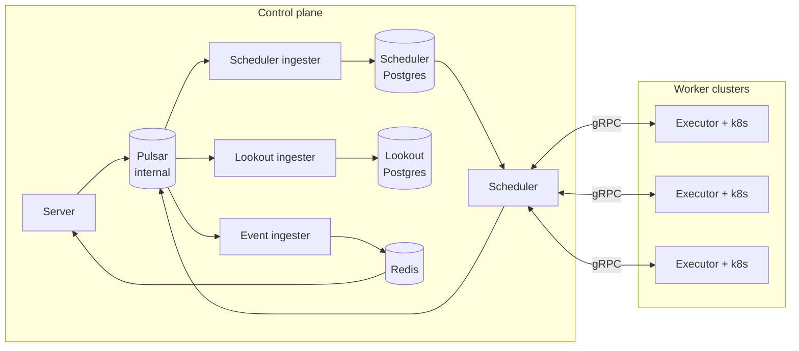

Pulsar is the internal event bus of the control plane. The server and the scheduler publish to Pulsar. The ingesters consume from it. The scheduler does not consume from Pulsar. It reads the scheduler Postgres database, which the scheduler ingester writes. Executors do not connect to Pulsar.

Executors reach the control plane through one gRPC service, `ExecutorApi`. The scheduler serves this service:

- **`LeaseJobRuns`**: a bidirectional stream. The executor opens the stream and sends one `LeaseRequest` message with its current state and capacity. The scheduler replies with `LeaseStreamMessage` values that contain new leases, cancel-runs instructions, or end markers, and then ends the stream. The executor opens a new stream on the next lease cycle. The proto also defines a preempt-runs instruction, but the scheduler never sends it.
- **`ReportEvents`**: a unary call. The executor sends batches of run-level event sequences to the scheduler. The handler in the scheduler authorises the caller and republishes the events to Pulsar.

This detail matters for the [run reconciliation flow](#run-reconciliation-and-the-executorscheduler-double-emission). One logical action can cause two separate Pulsar publications. One comes from the scheduler directly. The executor relays the other through `ReportEvents`. The two paths converge at Pulsar, and they have no guaranteed order relative to each other. In the typical case, the gRPC round trip sets the order.

## Components

A run is one attempt to start the pod. A job has a maximum of one active run at a time.

Control-plane components:

- **Server.** Accepts job submissions and cancel requests over its gRPC API. It validates the requests and publishes the related events to Pulsar.
- **Scheduler.** Owns scheduling decisions. It maintains an in-memory `jobdb` and reconciles it with the scheduler Postgres database on each cycle. Only the leader makes decisions. It emits its own run-level decision events (`JobRunLeased`, `JobRunPreempted`, `JobRunCancelled`, decision-time `JobRunErrors`) and the job-level decision events (`JobSucceeded`, `JobErrors`, `CancelledJob`, `JobRequeued`, `JobValidated`, `ReprioritisedJob`) to Pulsar.
- **Scheduler ingester.** Consumes events from Pulsar and writes to the scheduler Postgres database. The database is canonical. The `jobdb` is a cached view of it.
- **Lookout ingester.** Consumes the same events independently and writes to the Lookout Postgres database. That database drives the Lookout UI.
- **Event ingester.** Consumes events into Redis. Redis backs the external event-stream API. The ingester drops `JobRunSucceeded`, `JobValidated`, `JobRunTerminatedDebugInfo`, and every `JobRunErrors` reason except `LeaseExpired` and `PodLeaseReturned`. It also clears cancel reasons, start-up info, and debug messages.

Worker-cluster components:

- **Executor.** One per worker cluster, inside that cluster. It opens `LeaseJobRuns` streams and uses `ReportEvents` to send run events back. It creates and watches pods through the local Kubernetes API. It produces `JobRunAssigned`, `JobRunRunning`, `JobRunSucceeded`, and `JobRunErrors` from observed pod state. Its issue handler adds more `JobRunErrors` when a pod fails or disappears. It also emits `ResourceUtilisation`, `StandaloneIngressInfo`, and `JobRunTerminatedDebugInfo`. The executor also has a preempt processor that can emit `JobRunPreempted`, but the scheduler never triggers it (see [Job preempted](#job-preempted)).

Before the executor deletes a pod that it owns (cancel or detected issue), it writes the `deletion_requested` annotation (`domain.MarkedForDeletion`). The informer update path of the state reporter then skips phase-change reports for annotated pods. This prevents a duplicate terminal event for pods that the executor kills itself. The informer add path and the reconciliation pass do not check this annotation.

## Transport and edge cases

Some transport-level behaviours change how the flows below react to failure.

**The executor buffers and batches phase reports, and the reporter does not retry them.** The job-event reporter buffers events in a channel with 1,000,000 slots. It drains the channel every two seconds, or earlier when the batch is full. The event sender compacts each batch and splits it by message size, so one batch can produce more than one `ReportEvents` call. On failure, per-event callbacks receive the error, but the reporter does not retry the batch. The issue handler and the submission paths do not use this buffer for failure events. They call `Report` directly and receive the error.

Retries happen one layer up. The reconciliation pass of the state reporter re-emits phase events for pods whose current phase is not marked as reported that stayed in that phase for at least 30 seconds, and that have no queued events. The pass skips the Pending phase, so `JobRunAssigned` has no retry. The issue handler retries through its in-process `Reported` marker, which the executor loses on restart. The handler sets the marker only after a successful `Report` call, so the next handler tick retries a failed call. The preempt processor uses the `JobPreemptedAnnotation` pod annotation for the same purpose, but it is dead code in current deployments (see [Job preempted](#job-preempted)).

**The scheduler detects lease expiry from executor heartbeat staleness.** The executor sends one `LeaseRequest` per `LeaseJobRuns` stream. Each new stream is the heartbeat. The scheduler records the last time that it heard from each executor.

When an executor is silent for longer than the scheduler's `executorTimeout`, the next scheduler cycle acts. See [Lease expiry](#lease-expiry). The scheduler cannot separate "executor went away" from "stream momentarily lost". It acts on the absent heartbeat either way.

**Pulsar redelivery is effectively idempotent at the Postgres terminal-state writes.** `MarkRunsSucceeded`, `MarkRunsFailed`, and `MarkRunsPreempted` write timestamps taken from each event's `Created` field. A redelivered event carries the same `Created` value as the original, so a duplicate write produces the same column value. The scheduler ingester upserts the `job_run_errors` table on `run_id`, so a redelivered `JobRunErrors` overwrites with identical bytes.

The event ingester is different. It adds to the Redis stream with an automatic ID, so a redelivery adds a second entry. API watchers can see the same external event twice. The scheduler can also republish after a publish failure. A regenerated event has a new `Created` value.

The scheduler ingester does not write `JobRunCancelled` to the runs table. That event is in its explicit ignore list. It tracks job-level cancellation separately through `CancelledJob` and `MarkJobsCancelled`. The exception to this idempotence is the reconciliation double emission described in [Run reconciliation and the executor/scheduler double emission](#run-reconciliation-and-the-executorscheduler-double-emission). There, a separate producer writes a different event with different content, not a redelivery.

## State machines

Armada surfaces state at two levels: per job and per run. The public vocabulary lives in Lookout's enums, defined in `internal/common/database/lookout/jobstates.go`.

The internal model of the scheduler tracks boolean flags (`queued`, `failed`, `succeeded`, `cancelled`, plus `validated` for pre-queue validation), not a single state value. The mutually exclusive states are Queued, Running, Cancelled, Failed, and Succeeded. From Queued, the job can transition to Running, Cancelled, or Failed. From Running, it can transition to Queued (requeue), Cancelled, Failed, or Succeeded.

The scheduler's `Running` collapses Lookout's `Leased`, `Pending`, and `Running` into one state. Lookout derives `Preempted` and `Rejected` from the reason inside a `JobErrors` event. They are not scheduler-internal states. The tables below show the Lookout view, which is what API consumers see.

Lookout guards the job state but not the run state. Once a job is terminal, Lookout drops later job-state updates, with one exception: `Preempted` can replace `Succeeded`, `Failed`, or `Cancelled`. Run rows have no guard, and each event overwrites the columns that it sets. A run can therefore show `RUN_FAILED` under a `PREEMPTED` job.

The executor reports only the current phase of a pod, so a run can skip `Pending` or `Running`. For example, `Leased` to `Running` occurs only when `JobRunAssigned` is missing.

### Job state

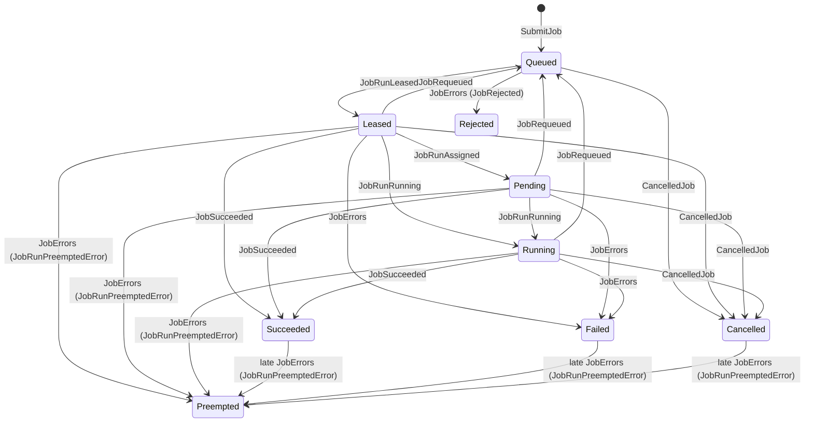

| From                                | To        | Driven by                                                  |
| ----------------------------------- | --------- | ---------------------------------------------------------- |
| (new)                               | Queued    | server publishes `SubmitJob`                               |
| Queued                              | Leased    | `JobRunLeased`                                             |
| Leased                              | Pending   | `JobRunAssigned`                                           |
| Leased / Pending                    | Running   | `JobRunRunning`                                            |
| Leased / Pending / Running          | Queued    | `JobRequeued`                                              |
| Leased / Pending / Running          | Succeeded | `JobSucceeded`                                             |
| Leased / Pending / Running          | Failed    | `JobErrors` (Terminal=true, default case)                  |
| Leased / Pending / Running          | Preempted | `JobErrors` with `JobRunPreemptedError` reason             |
| Succeeded / Failed / Cancelled      | Preempted | late `JobErrors` with `JobRunPreemptedError` reason        |
| Queued                              | Rejected  | `JobErrors` with `JobRejected` reason                      |
| Queued / Leased / Pending / Running | Cancelled | `CancelledJob`                                             |

### Run state

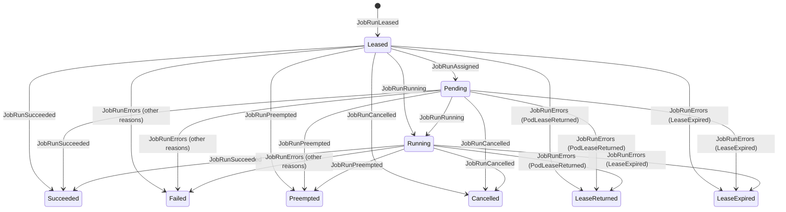

| From                       | To            | Driven by                                                                                           |
| -------------------------- | ------------- | --------------------------------------------------------------------------------------------------- |
| (new)                      | Leased        | `JobRunLeased`                                                                                      |
| Leased                     | Pending       | `JobRunAssigned`                                                                                    |
| Leased / Pending           | Running       | `JobRunRunning`                                                                                     |
| Leased / Pending / Running | Succeeded     | `JobRunSucceeded`                                                                                   |
| Leased / Pending / Running | Failed        | `JobRunErrors` with any reason except `PodLeaseReturned`, `LeaseExpired`, or `JobRunPreemptedError` |
| Leased / Pending / Running | Preempted     | `JobRunPreempted`                                                                                   |
| Leased / Pending / Running | Cancelled     | `JobRunCancelled`                                                                                   |
| Leased / Pending / Running | LeaseReturned | `JobRunErrors` (`PodLeaseReturned`)                                                                 |
| Leased / Pending / Running | LeaseExpired  | `JobRunErrors` (`LeaseExpired`, emitted on stale executor)                                          |

A run returns its lease from `Leased` when pod creation fails with a recoverable error. It returns its lease from `Running` when a pod with started containers matches a configured failed-container check.

The diagram shows only the edges from active states. Run rows have no guard, so a late event can also change a terminal run state, for example `LeaseReturned` to `Cancelled`.

`MaxRunsExceeded`, `UnableToSchedule`, and `Terminated` exist as enum values in the Lookout run-state enum, but no current emission path drives them. When the scheduler caps retries with the default configuration, it emits `MaxRunsExceeded` only as a job-level `JobErrors`. That event reaches Lookout's job-level handler, which records the job as `Failed`. It never reaches the run-level `JobRunErrors` handler. The earlier run-level error that triggered the final retry already recorded the run as `Failed` or `LeaseReturned`.

One exception sits behind the `retryPolicy.enabled` flag, which is off by default. When a retry policy declines to retry an expired lease, the scheduler emits `MaxRunsExceeded` as both a run-level `JobRunErrors` and a job-level `JobErrors`. Lookout has no run-level case for that reason, so the run still becomes `Failed`.

## Event vocabulary

A reference for the events used in the flows below.

**Run-level internal events** describe what happened to a single run.

| Event                       | Emitted by                                 | Carries                                                                                                                         |
| --------------------------- | ------------------------------------------ | ------------------------------------------------------------------------------------------------------------------------------- |
| `JobRunLeased`              | scheduler                                  | executor ID, node ID, pool, scheduling priority                                                                                 |
| `JobRunAssigned`            | executor                                   | pod identity (pod number, no node name), pool                                                                                   |
| `JobRunRunning`             | executor                                   | pod identity (node name, pod number), pool, start-up info                                                                       |
| `JobRunSucceeded`           | executor                                   | pod identity                                                                                                                    |
| `JobRunErrors`              | executor or scheduler                      | one or more `Error` values; each has a reason (oneof) plus optional `failure_category`, `failure_subcategory`, `retry_policy_name` |
| `JobRunPreempted`           | scheduler (the executor path is dead code) | preempted run ID, preempted job ID, preempting job ID, preemption reason text, requestor                                        |
| `JobRunCancelled`           | scheduler                                  | run ID, job ID, cancel reason, requestor                                                                                        |
| `JobRunTerminatedDebugInfo` | executor                                   | run ID, job ID, debug message (diagnostic only, no state change)                                                                |
| `StandaloneIngressInfo`     | executor                                   | pod identity, ingress addresses                                                                                                 |
| `ResourceUtilisation`       | executor                                   | pod identity, resource usage                                                                                                    |

The `Error.reason` oneof inside `JobRunErrors` has eleven variants: `KubernetesError`, `ContainerError`, `ExecutorError`, `LeaseExpired`, `MaxRunsExceeded`, `PodError`, `PodLeaseReturned`, `JobRunPreemptedError`, `GangJobUnschedulable`, `JobRejected`, `ReconciliationError`. Nothing emits `KubernetesError`, `ContainerError`, `ExecutorError`, or `GangJobUnschedulable`.

Preemption errors carry the failure category `preemption` and the preemption type as the subcategory: `fairshare`, `urgency`, `optimiser`, `api`, `reconciler`, `unknown`, or `unknown-gang`.

**Request events** ask for a change. The scheduler ingester turns them into Postgres writes, and the scheduler acts on a later cycle.

| Event                    | Emitted by           | Carries                 |
| ------------------------ | -------------------- | ----------------------- |
| `SubmitJob`              | server               | job spec                |
| `CancelJob`              | server or scheduler  | job ID, optional reason |
| `CancelJobSet`           | server               | job states, reason      |
| `JobPreemptionRequested` | server               | job ID, reason          |
| `ReprioritiseJob`        | server               | job ID, priority        |
| `ReprioritiseJobSet`     | server               | priority                |

Two other events are outside the lifecycle. The scheduler publisher emits `PartitionMarker` to check that the database is up to date. Nothing emits `JobRunPreemptionRequested`.

**Job-level internal events** come from the scheduler. It emits most of them when it concludes that the job reaches a terminal state or must requeue. This usually happens one scheduler cycle after the related run-level event lands in the database. These events do not wait for a scheduling round, because the scheduler generates them on every cycle.

| Event              | Emitted by | Carries                                                                                 |
| ------------------ | ---------- | --------------------------------------------------------------------------------------- |
| `JobSucceeded`     | scheduler  | job ID                                                                                  |
| `JobErrors`        | scheduler  | one or more `Error` values, where the reason discriminates Failed/Preempted/Rejected    |
| `CancelledJob`     | scheduler  | job ID, cancel user (the proto has a `reason` field, but the scheduler does not set it) |
| `JobRequeued`      | scheduler  | job ID, updated scheduling info, queued version (in the `update_sequence_number` field) |
| `JobValidated`     | scheduler  | job ID, pools                                                                           |
| `ReprioritisedJob` | scheduler  | job ID, priority, requestor                                                             |

**External API events** are what watchers of the event-stream API see. The conversion layer maps internal events to external events. Some internal events have no external counterpart, and the event ingester or the conversion layer drops them.

| Internal event              | External event                                    | Notes                                                                                                       |
| --------------------------- | ------------------------------------------------- | ----------------------------------------------------------------------------------------------------------- |
| `SubmitJob`                 | `JobSubmittedEvent` and `JobQueuedEvent`          |                                                                                                             |
| `JobRunLeased`              | `JobLeasedEvent`                                  |                                                                                                             |
| `JobRunAssigned`            | `JobPendingEvent`                                 |                                                                                                             |
| `JobRunRunning`             | `JobRunningEvent`                                 |                                                                                                             |
| `JobSucceeded` (job-level)  | `JobSucceededEvent`                               |                                                                                                             |
| `JobErrors` (job-level)     | `JobFailedEvent`                                  | Reason-discriminated conversion. Carries reason, category, subcategory. A non-terminal `JobErrors` also converts, flagged `Retryable=true`. |
| `CancelJob`                 | `JobCancellingEvent`                              | The external `reason` field stays empty.                                                                    |
| `CancelledJob`              | `JobCancelledEvent`                               | The external `reason` field stays empty (see [Job cancelled](#job-cancelled)).                              |
| `JobPreemptionRequested`    | `JobPreemptingEvent`                              |                                                                                                             |
| `JobRunPreempted`           | `JobPreemptedEvent`                               |                                                                                                             |
| `ReprioritiseJob`           | `JobReprioritizingEvent`                          |                                                                                                             |
| `ReprioritisedJob`          | `JobReprioritizedEvent`                           |                                                                                                             |
| `ResourceUtilisation`       | `JobUtilisationEvent`                             |                                                                                                             |
| `StandaloneIngressInfo`     | `JobIngressInfoEvent`                             |                                                                                                             |
| `JobRunErrors`              | `JobLeaseReturnedEvent` or `JobLeaseExpiredEvent` | Only for `PodLeaseReturned` and `LeaseExpired` reasons. All other reasons have no external event.           |
| `JobRunSucceeded`           | (none)                                            | API watchers see success through the job-level `JobSucceeded`.                                              |
| `JobRunCancelled`           | (none)                                            | API watchers see cancellation through the job-level `CancelledJob`.                                         |
| `JobRequeued`               | (none)                                            | API watchers see the next `JobLeasedEvent`. They do not see a second `JobQueuedEvent`.                      |
| `JobValidated`              | (none)                                            |                                                                                                             |
| `JobRunTerminatedDebugInfo` | (none)                                            | Only Lookout stores this event.                                                                             |
| `CancelJobSet`              | (none)                                            | API watchers see one `JobCancellingEvent` per job (see [Job-set and control-plane cancellation](#job-set-and-control-plane-cancellation)). |
| `ReprioritiseJobSet`        | (none)                                            |                                                                                                             |

API watchers see the success or failure of a job only after the scheduler emits its job-level event. That is one scheduler cycle later than the actual run finish. Lookout consumes the run-level events directly. It updates the run-state column promptly and the terminal job-state column with the same lag.

## Job succeeded

- **Run state:** `Running` to `Succeeded`.
- **Job state:** to `Succeeded`, from any non-terminal state.

Events fired in this flow:

| Event             | Phase | Emitted by | Payload      |
| ----------------- | ----- | ---------- | ------------ |
| `JobRunSucceeded` | 1     | executor   | pod identity |
| `JobSucceeded`    | 2     | scheduler  | job ID       |

Phase 1, observation, the executor:

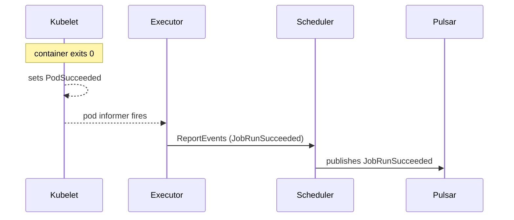

The scheduler ingester writes `runs.succeeded = true, terminated_timestamp`. The lookout ingester writes the run state.

Phase 2, conclusion, the scheduler:

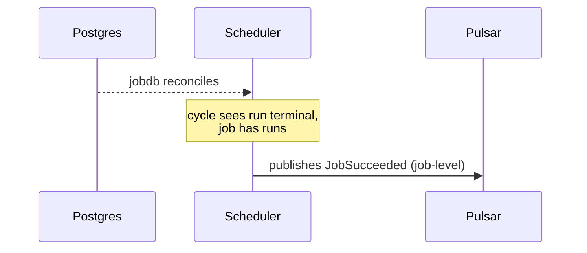

The scheduler ingester writes `jobs.succeeded = true`. The lookout ingester writes the job state. The conversion layer ignores `JobRunSucceeded` and converts `JobSucceeded` to `JobSucceededEvent` for the external API stream.

## Job failed

Several emission paths reach this flow, depending on who detected the failure. Paths A and B cover failures of an existing pod. [Other failure sources](#other-failure-sources) lists the rest.

### Path A: pod reaches terminal phase

- **Run state:** `Running` to `Failed`. A pod that exits before the executor observes it `Running`, for example an immediate non-zero exit, goes `Pending` to `Failed`.
- **Job state:** to `Failed` if terminal, or back to `Queued` if requeued.

Events fired in this flow:

| Event          | Phase | Emitted by | Payload                                                       |
| -------------- | ----- | ---------- | ------------------------------------------------------------- |
| `JobRunErrors` | 1     | executor   | `PodError` reason, `failure_category`, `failure_subcategory`  |
| `JobErrors`    | 2     | scheduler  | run error reason, or `MaxRunsExceeded` when a retry policy decides, Terminal=true |
| `JobErrors`    | 2     | scheduler  | run error reason, Terminal=false (retry policy retries only, before `JobRequeued`) |
| `JobRequeued`  | 2     | scheduler  | (alternative to the terminal `JobErrors` when a retry policy grants a retry)  |

Phase 1, observation, the executor:

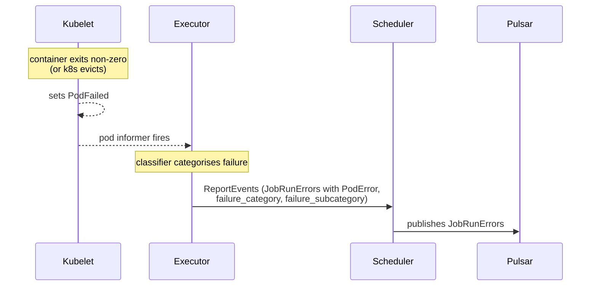

The scheduler ingester writes `runs.failed = true, terminated_timestamp` and inserts a row into `job_run_errors`. The lookout ingester writes the run state.

Phase 2, conclusion, the scheduler:

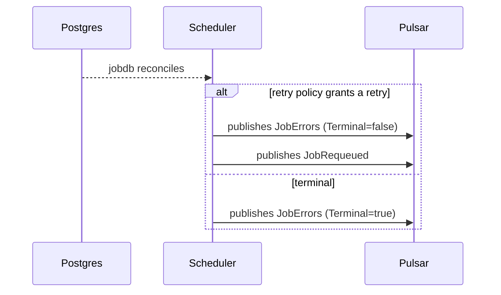

The requeue here is conditional. Without a retry policy, a failed run is requeue-eligible only if it was *returned*, which means the run carried a `PodLeaseReturned` error. The scheduler does not requeue failures with a `PodError` reason. It marks the job failed on the next cycle.

Returned runs have three more gates, described in [Lease return and requeue](#lease-return-and-requeue). When the `retryPolicy.enabled` flag is on, a matching retry policy can override this rule and also requeue `PodError` failures. See [retry_policies.md](../retry_policies.md).

The conversion layer converts the scheduler's job-level `JobErrors` to `JobFailedEvent` for the API stream. The executor's `JobRunErrors` does not produce an external API event for `PodError`-reason failures. It only does so for `LeaseExpired` and `PodLeaseReturned`.

### Path B: executor's issue handler detects a problem first

The issue handler handles managed pods with failure modes that the state reporter cannot report alone. Most of them surface before the pod's terminal phase. `FailedStartingUp` and `DeleteActionFailure` start when the state reporter sees `PodFailed` and hands the pod to the handler. `ExternallyDeleted` starts when the pod disappears. Its `podIssueType` enum has eight values: `UnableToSchedule`, `StuckStartingUp`, `StuckTerminating`, `ActiveDeadlineExceeded`, `ExternallyDeleted`, `ErrorDuringIssueHandling`, `FailedStartingUp`, and `DeleteActionFailure`. Detection only registers the issue in memory. A periodic tick then processes the registered issues.

The order of report and delete depends on the issue type:

- For a non-retryable issue, the handler reports the failure event first and then deletes the pod.
- For a retryable issue, the handler deletes the pod first. It reports `PodLeaseReturned` only after the pod is gone.
- For `DeleteActionFailure`, the handler also reports only after the pod is confirmed gone. If the pod outlives `stuckTerminatingPodExpiry`, the handler reports an internal stuck-terminating failure while the pod still exists.

Events fired in this flow:

| Event          | Phase | Emitted by | Payload                                                                                                          |
| -------------- | ----- | ---------- | ---------------------------------------------------------------------------------------------------------------- |
| `JobRunErrors` | 1     | executor   | `PodError` (or `PodLeaseReturned` for retryable issues) reason, category, subcategory                            |
| `JobErrors`    | 2     | scheduler  | run error reason, or `MaxRunsExceeded` for a capped lease return or a retry policy decision, Terminal=true       |
| `JobRequeued`  | 2     | scheduler  | (alternative to the terminal `JobErrors` when the issue produced a `PodLeaseReturned` and the run is otherwise eligible) |

The diagram shows the non-retryable path:

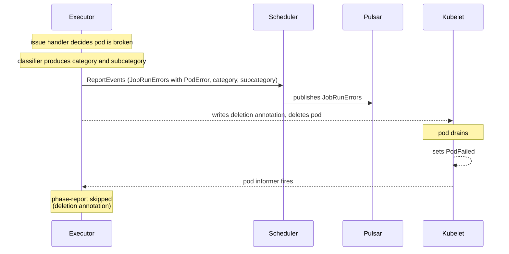

The state reporter skips the terminal-phase tick because the pod is marked for deletion. Downstream from there, the flow matches path A. The scheduler ingester writes the run as failed, the scheduler concludes the job's fate on a later cycle, and the conversion layer surfaces a `JobFailedEvent` if the result was terminal.

This path differs from path A in timing and payload. On the non-retryable path, the handler emits `JobRunErrors` at the handler tick, not at pod-drain time. The event carries the message and the category of the issue, not the kubelet failure reason. `StuckTerminating`, `ActiveDeadlineExceeded`, `ExternallyDeleted`, and `ErrorDuringIssueHandling` have no path A equivalent. The gap between event emission and the actual pod stop can be tens of seconds when Kubernetes honours a long `terminationGracePeriodSeconds` before SIGKILL.

### Other failure sources

| Source                         | Trigger                                                     | Event                                                   |
| ------------------------------ | ----------------------------------------------------------- | ------------------------------------------------------- |
| executor job requester         | the executor cannot build a pod from the lease              | `JobRunErrors` with `PodError`                          |
| executor cluster allocation    | pod creation fails with a recoverable error                 | `JobRunErrors` with `PodLeaseReturned`                  |
| executor cluster allocation    | pod creation fails with a fatal error                       | `JobRunErrors` with `PodError`                          |
| executor issue handler         | the pod of an active run stays missing past `deadlineForActivePodConsideredMissing` | `JobRunErrors` with `PodError`                          |
| scheduler                      | [lease expiry](#lease-expiry)                               | `JobRunErrors` and `JobErrors` in one cycle             |
| scheduler                      | run reconciliation of a non-preemptible job                 | `JobRunErrors` and `JobErrors` with `ReconciliationError` |
| scheduler                      | [job rejection](#job-rejected)                              | `JobErrors` only                                        |

If the pod of a submitted run does not appear within `deadlineForSubmittedPodConsideredMissing`, the executor removes the run from its state and emits no event. The scheduler then sends the same lease again.

## Job preempted

- **Run state:** `Leased`, `Pending`, or `Running` to `Preempted`.
- **Job state:** to `Preempted`, once the scheduler emits the job-level `JobErrors` with `JobRunPreemptedError` reason.

Three distinct mechanisms drive a run to `Preempted`. The common one is scheduler-initiated preemption (fair share, urgency, or optimiser), described first. The second is a request through the API or the control plane. The third, experimental one is run reconciliation. That one can produce a genuine executor-and-scheduler double emission; see [Run reconciliation and the executor/scheduler double emission](#run-reconciliation-and-the-executorscheduler-double-emission).

### Scheduler-initiated preemption

When the scheduling algorithm decides to preempt a run, the scheduler generates all of the preemption events itself, in the same cycle, at decision time (`createEventsForPreemptedJob`). The scheduler does **not** ask the executor to preempt. It marks the run failed, which makes the run terminal through the generated `runs.terminated` column. On the next lease request the scheduler finds the run inactive and tells the executor to **cancel** it. The executor's remove-runs processor deletes the pod and emits no state-changing events. It can emit one diagnostic `JobRunTerminatedDebugInfo` event when the main container never started (see [Job cancelled](#job-cancelled)).

Events fired in this flow (all from the scheduler):

| Event             | Phase | Emitted by | Payload                                                                                             |
| ----------------- | ----- | ---------- | --------------------------------------------------------------------------------------------------- |
| `JobRunPreempted` | 1     | scheduler  | preempted run ID, preempting job ID, scheduler's preemption reason                                  |
| `JobRunErrors`    | 1     | scheduler  | Terminal=true, `JobRunPreemptedError`, scheduler's reason, category, preemption type                |
| `JobErrors`       | 1     | scheduler  | Terminal=true, `JobRunPreemptedError` reason, category, preemption type (drives Preempted job state) |

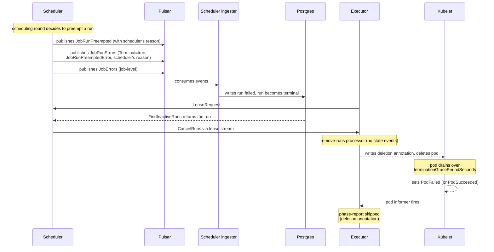

The single `JobRunPreempted` becomes one `JobPreemptedEvent` on the external API. The conversion layer drops the scheduler's run-level `JobRunErrors` (`JobRunPreemptedError` reason). The scheduler's job-level `JobErrors` becomes the single `JobFailedEvent`, and the `JobRunPreemptedError` reason drives the Lookout job state to Preempted, not Failed.

The executor does have a preempt processor (`preempt_runs.go`). It can emit its own `JobRunPreempted` and a generic `PodError` ("Run preempted") `JobRunErrors`. It fires only for runs flagged `PreemptionRequested`, and only a `PreemptRuns` instruction over the lease stream sets that flag. The scheduler never constructs that message. The lease stream only ever carries `Lease`, `CancelRuns`, and `End`, so this processor is currently dead code. Scheduler-initiated preemption therefore has one preemption producer: no duplicate `JobPreemptedEvent`.

The executor can still report the pod during the teardown window. A pod that ends before the executor writes the deletion annotation produces a normal `JobRunSucceeded` or `JobRunErrors`. That event overwrites the run row in Lookout, and a `JobRunErrors` overwrites `job_run_errors`. The job stays `Preempted`.

### API and control-plane preemption

A user can request preemption through `PreemptJobs`. An operator can request it for an executor, a node, or a queue through a control-plane event. Both set `preempt_requested` on the non-terminal runs of the job. The scheduler then emits the same three events on a later cycle, with the `api` preemption type. It does not wait for a scheduling round.

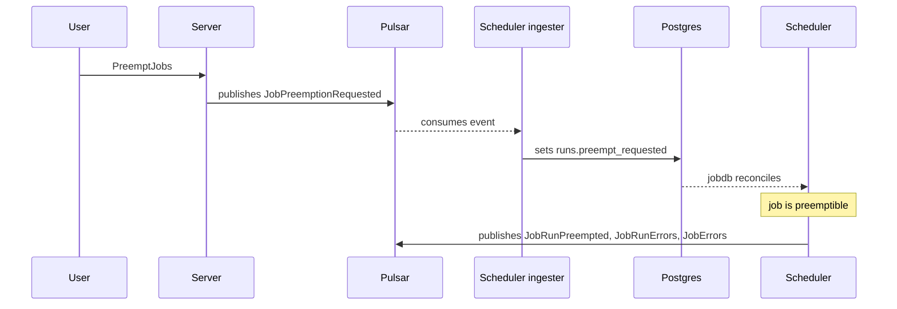

After these events, the teardown matches [scheduler-initiated preemption](#scheduler-initiated-preemption). `JobPreemptionRequested` converts to `JobPreemptingEvent`. The scheduler ignores the request for a non-preemptible job and emits no more events, but API watchers already saw `JobPreemptingEvent`. A job with no active run also ignores the request.

### Run reconciliation and the executor/scheduler double emission

A real executor-and-scheduler double emission exists. It is gated behind the experimental per-pool `ExperimentalRunReconciliation` feature, a `*RunReconciliationConfig` pointer that is `nil`/off by default and not set in any shipped config. Node invalidation triggers it, not fair-share preemption.

When the feature is on, the run-vs-node reconciler of the scheduler (`RunNodeReconciler`) flags a leased run as invalid in these cases:

- No executor reports the run's node any more (a deleted node; gang jobs only).
- The node's pool has changed.
- The job does not match the node's reservation (behind the `EnsureReservationMatch` flag).
- The job runs away on a node whose reservation matches the job (behind the `EnsureReservationDoesNotMatch` flag).

When a preemptible gang member becomes invalid, the reconciler also preempts the other preemptible members of that gang. A non-preemptible invalid member does not affect the other members. For a preemptible job the reconciler emits the full preemption set: `JobRunPreempted`, run-level `JobRunErrors` with `JobRunPreemptedError`, and job-level `JobErrors`. For a non-preemptible job it emits `JobRunErrors`/`JobErrors` with the `ReconciliationError` reason instead.

The double emission arises in the deleted-node case, where the pod genuinely disappears. The executor's issue handler independently detects that the pod is gone without Armada's deletion annotation. It registers an `ExternallyDeleted` issue and emits its own run-level `JobRunErrors` with a `PodError` reason ("Pod was unexpectedly deleted"). So two producers emit a run-level error for the same run. Pool-change and reservation reconciliation leave the pod healthy, so the executor stays silent and those cases remain scheduler-only.

- The executor's `PodError` and the scheduler's `JobRunPreemptedError` both upsert `job_run_errors` keyed on `run_id`, so the second write overwrites the first. `MarkRunsFailed` has no `IS NULL` guard, so the second write also overwrites `runs.terminated_timestamp`.
- The executor usually reports first, because it observes the pod loss before the next scheduling cycle runs. The usual order is therefore executor-then-scheduler. This is timing, not a guarantee.
- It is a race. If the executor's failure reaches the scheduler database before the reconciliation cycle runs, the cycle marks the job terminal before the reconciler looks at it. The reconciler skips terminal jobs (its guard checks the job's flags, not the run's), so no preemption event appears and the run ends as `Failed`. The double emission appears only when the reconciliation cycle runs before the executor's failure reaches the scheduler database.

On the external API this still yields a single `JobPreemptedEvent`, because only the scheduler emits `JobRunPreempted`. The event ingester drops the executor's run-level `JobRunErrors`. For `JobRunErrors` with `JobRunPreemptedError` reason, the lookout ingester stores only the failure category and subcategory, because `JobRunPreempted` sets the run state and the error text. It does store the executor's `PodError`-reason emission. Lookout keeps the last non-null value per column (`coalesce(new, existing)`). Both writes set the run state and the error text, so the later write sets the final values.

## Job cancelled

- **Run state:** any non-terminal state to `Cancelled`.
- **Job state:** any non-terminal state to `Cancelled`.

Events fired in this flow:

| Event             | Phase | Emitted by | Payload                                                          |
| ----------------- | ----- | ---------- | ---------------------------------------------------------------- |
| `CancelJob`       | input | server     | job ID, cancel reason                                            |
| `JobRunCancelled` | 1     | scheduler  | latest run ID, job ID, cancel reason, requestor (only if the job has a run) |
| `CancelledJob`    | 1     | scheduler  | job ID, cancel user                                              |

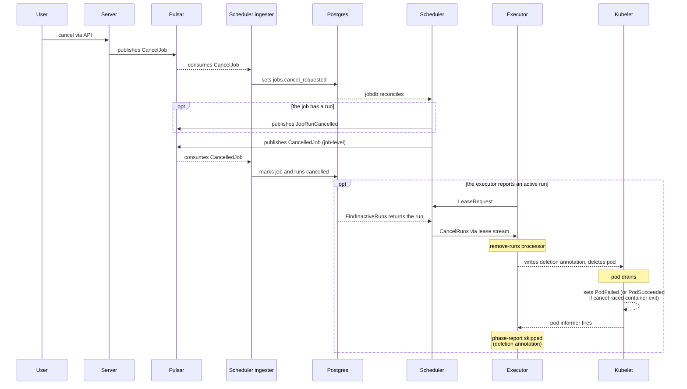

The executor's cancel path emits no state-changing events. When the main container never started, the remove-runs processor emits one diagnostic `JobRunTerminatedDebugInfo` event whose `debugMessage` is a JSON document describing the pod, its node and the most recent Kubernetes events for both, so the reason the workload never ran survives the teardown. The pod issue handler emits the same event for a pod that outlives its deletion deadline while Armada is deleting it. The same JSON shape is used for `PodError.debugMessage`; it carries a `schemaVersion` and a `trigger` naming which situation produced it. `application.debugEvents.enabled` gates all of it: with capture off the renderer produces nothing, the debug field is left empty everywhere, and the two events that exist only to carry a payload are not emitted at all. Only Lookout stores that event. Otherwise, cancellation is a clean teardown that the scheduler drives. The teardown window of [scheduler-initiated preemption](#scheduler-initiated-preemption) also applies here.

In one cycle, the scheduler checks cancel requests before run outcomes. A job whose run succeeded and that has a cancel request ends `Cancelled`, with no `JobSucceeded`.

`JobRunCancelled` names the latest run of the job, even when that run already ended. For example, a requeued job has a returned run. Lookout then changes that run to `Cancelled`.

The scheduler ingester ignores `JobRunCancelled` (it is in the explicit ignore list) and writes cancellation through `MarkJobsCancelled` from `CancelledJob`. `MarkJobsCancelled` also stamps the runs table (`cancelled=true`, `terminated_timestamp`) keyed on `job_id`, so it updates every run of the job, including earlier runs. The run's cancelled state in the scheduler database therefore comes from this job-level cascade, not from the ignored `JobRunCancelled`. The lookout ingester writes both the run state and the job state.

The conversion layer ignores `JobRunCancelled` and converts `CancelledJob` to `JobCancelledEvent` for the API stream. The cancel reason travels only on `CancelJob`, `CancelJobSet`, and `JobRunCancelled`. The external `JobCancellingEvent` and `JobCancelledEvent` carry no reason, because the event ingester clears the reason and the conversion layer does not copy it. The scheduler also leaves the `reason` field on `CancelledJob` unset, so Lookout stores the reason only on the run, as the scheduler termination reason.

### Job-set and control-plane cancellation

`CancelJobSet` sets `cancel_by_jobset_requested` on the matching jobs. The scheduler then emits `CancelJob`, `JobRunCancelled` (if the job has a run), and `CancelledJob` for each job. That `CancelJob` gives API watchers a per-job `JobCancellingEvent`.

The `CancelOnQueue`, `CancelOnExecutor`, and `CancelOnNode` control-plane events set `cancel_requested` on the matching jobs. From there, the flow matches [Job cancelled](#job-cancelled).

## Lease return and requeue

- **Run state:** to `LeaseReturned`.
- **Job state:** back to `Queued`, or to `Failed` if a gate stops the requeue.

An executor returns a lease when the pod cannot start, or when pod creation fails with a recoverable error. The scheduler requeues the job only if all of these gates pass:

- The `armadaproject.io/failFast` annotation is not `true`.
- The attempt count is below `scheduling.maxRetries` plus 1. Only runs with `run_attempted=true` count. `UnableToSchedule` issues do not set it.
- For an attempted run, the job still fits a node after the scheduler adds node anti-affinity for the attempted nodes.

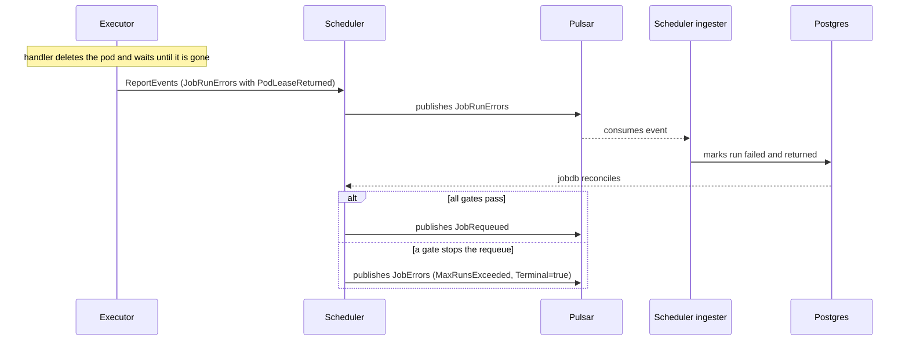

API watchers see `JobLeaseReturnedEvent` and then `JobLeasedEvent` for the new run, or `JobFailedEvent` if a gate stops the requeue. Retry policies do not decide lease returns. They also do not decide for gang jobs or `failFast` jobs.

## Lease expiry

- **Run state:** to `LeaseExpired`.
- **Job state:** to `Failed` by default.

The scheduler detects a stale executor on every cycle. For each job that is not queued and not terminal, and whose latest run belongs to that executor, it emits both events in one cycle, with no lag between them.

| Case                    | Events                                                                       |
| ----------------------- | ---------------------------------------------------------------------------- |
| default                 | `JobRunErrors` and `JobErrors`, with `LeaseExpired`, Terminal=true           |
| retry policy retries    | `JobRunErrors` (`LeaseExpired`), `JobErrors` (Terminal=false), `JobRequeued` |
| retry policy declines   | `JobRunErrors` and `JobErrors`, with `MaxRunsExceeded`, Terminal=true        |

API watchers see `JobLeaseExpiredEvent` and `JobFailedEvent` by default. When a retry policy retries, they see `JobLeaseExpiredEvent`, `JobFailedEvent` with `Retryable=true`, and then `JobLeasedEvent` for the new run. When a retry policy declines, they see only `JobFailedEvent`, and Lookout shows the run as `Failed`. If the executor returns, the scheduler tells it to cancel the run.

## Job rejected

- **Run state:** no run exists.
- **Job state:** `Queued` to `Rejected`.

The scheduler checks each unvalidated job on every cycle. It skips jobs in cordoned queues. If the job can be scheduled, the scheduler emits `JobValidated`. Otherwise, it emits a job-level `JobErrors` with `JobRejected` reason and Terminal=true.

The scheduler ingester marks the job failed. Lookout records the job as `Rejected` and stores the message. API watchers see `JobFailedEvent` with the `Rejected` cause.
