# Job lifecycle: states, transitions, and events

- [Job lifecycle: states, transitions, and events](#job-lifecycle-states-transitions-and-events)
  - [Terms](#terms)
  - [Architecture](#architecture)
    - [Components](#components)
    - [Executor API](#executor-api)
  - [The normal path: from submission to success](#the-normal-path-from-submission-to-success)
  - [States](#states)
    - [Job state](#job-state)
    - [Run state](#run-state)
    - [Run state in the executor](#run-state-in-the-executor)
  - [Event reference](#event-reference)
    - [Request events](#request-events)
    - [Run-level events](#run-level-events)
    - [Job-level events](#job-level-events)
    - [Error values](#error-values)
    - [Events that watchers receive](#events-that-watchers-receive)
  - [Job failed](#job-failed)
    - [The pod fails](#the-pod-fails)
    - [The issue handler finds a problem](#the-issue-handler-finds-a-problem)
    - [Other failure sources](#other-failure-sources)
  - [Retry and requeue](#retry-and-requeue)
  - [Lease expiry](#lease-expiry)
  - [Job preempted](#job-preempted)
    - [Preemption by the scheduler](#preemption-by-the-scheduler)
    - [Preemption on request](#preemption-on-request)
    - [Run reconciliation](#run-reconciliation)
  - [Job cancelled](#job-cancelled)
    - [Job-set and control-plane cancellation](#job-set-and-control-plane-cancellation)
  - [Job reprioritised](#job-reprioritised)
  - [Job rejected](#job-rejected)
  - [Delivery, retries, and duplicates](#delivery-retries-and-duplicates)
    - [Executor reports](#executor-reports)
    - [Pulsar redelivery](#pulsar-redelivery)
    - [Events that the scheduler generates again](#events-that-the-scheduler-generates-again)
  - [Pod deletion and debug events](#pod-deletion-and-debug-events)

This document describes how a job moves through Armada. It shows the states of a job and of a run, the events that change them, and the flows that start, end, or requeue a job. Use it to find which component emits an event, what the event carries, and what Lookout and API watchers see.

For scheduling and preemption decisions, see [scheduling_and_preempting_jobs.md](../scheduling_and_preempting_jobs.md). For retry policies, see [retry_policies.md](../retry_policies.md).

## Terms

| Term          | Meaning                                                                                                     |
| ------------- | ----------------------------------------------------------------------------------------------------------- |
| job           | The unit of work that a user submits. It has one pod spec.                                                  |
| job set       | A group of jobs that a user submits together and can watch, cancel, or reprioritise together.               |
| run           | One attempt to run the pod of a job on an executor. A job has a maximum of one active run at a time.        |
| lease         | The assignment of a run to an executor and a node.                                                          |
| executor      | The Armada component in a worker Kubernetes cluster. It creates and watches the pods.                       |
| event         | A protobuf message in the `armadaevents` package. The components publish events to Pulsar.                  |
| watcher       | A client of the event-stream API (`GetJobSetEvents` or `Watch`), for example `armadactl watch`.             |
| Lookout       | The Armada web UI and its database. It shows the state of each job and each run.                            |
| cycle         | One pass of the scheduler loop. A cycle reads the database, generates events, and can run a scheduling round. |

## Architecture

Armada runs one control plane and one executor in each worker Kubernetes cluster.

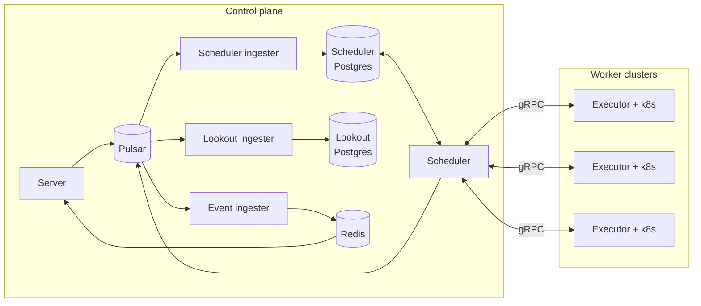

All state changes go through Pulsar. The server and the scheduler publish events, and three ingesters consume them. The scheduler reads its state from the scheduler database. It also writes executor heartbeats to that database.

### Components

- **Server.** Accepts submissions and requests through its gRPC API. It validates each request and publishes the related events. It also serves the event-stream API from Redis.
- **Scheduler.** Makes the scheduling decisions and publishes them as events. Only the leader instance makes decisions. It keeps an in-memory copy of the jobs (`jobdb`) and updates it from the scheduler database on each cycle.
- **Scheduler ingester.** Writes events to the scheduler database. This database is the source of truth for the scheduler.
- **Lookout ingester.** Writes events to the Lookout database.
- **Event ingester.** Writes events to Redis for watchers. It removes the events and fields that watchers do not use. See [Events that watchers receive](#events-that-watchers-receive).
- **Executor.** Creates pods from leases and reports what happens to them. The state reporter reports pod phases. The issue handler reports pods that fail to start, stay stuck, or disappear.

### Executor API

Executors connect to the scheduler through the `ExecutorApi` gRPC service:

- **`LeaseJobRuns`** is a bidirectional stream. The executor sends one `LeaseRequest` with its nodes, its capacity, and its runs. The scheduler sends the runs to cancel, the new leases, and an end marker, and then closes the stream. The executor opens a new stream on its next lease cycle.
- **`ReportEvents`** is a unary call. The executor sends batches of run-level events. The scheduler authorises the call and publishes the events to Pulsar.

Each `LeaseRequest` is also a heartbeat. The scheduler stores the time of the last heartbeat of each executor, and uses it to find [expired leases](#lease-expiry).

## The normal path: from submission to success

This flow shows a job that runs once and succeeds.

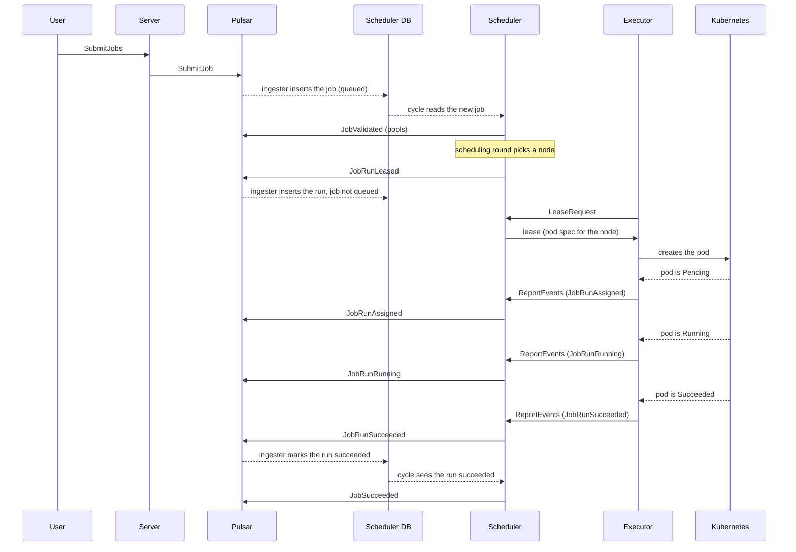

The steps are:

1. **Submit.** The server checks the permissions of the user and validates the request. If a job has the client ID of an earlier job in the same queue, the server returns the earlier job ID for that job and publishes no `SubmitJob` for it. For each other job, it publishes `SubmitJob`.
2. **Queue.** The scheduler ingester inserts the job with `queued=true`. Lookout shows the job as `Queued`, and watchers receive `JobSubmittedEvent` and `JobQueuedEvent`.
3. **Validate.** The scheduler checks that the job can run on a node in at least one pool. It emits `JobValidated` with the pools. The scheduler considers a job only in the pools of its `JobValidated` event. See [Job rejected](#job-rejected) for a job that fails this check.
4. **Lease.** A scheduling round assigns the job to an executor and a node, and emits `JobRunLeased`. The scheduler ingester inserts the run and sets `queued=false` on the job. The queued version on the event stops an old lease from overwriting a later requeue.
5. **Send the lease.** On the next `LeaseRequest` from that executor, the scheduler reads the new runs from the database. It sends each run with a pod spec that it changes for the lease:
   - a node selector for the node
   - the pool annotation
   - the tolerations, annotations, and resource changes of the run (for example, a memory increase from a retry policy)
   - the preemptible label
   - the priority class override, if it is configured
6. **Create the pod.** The executor stores the run as `Leased` and creates the pod. If pod creation fails, see [Other failure sources](#other-failure-sources).
7. **Report the pod phases.** The state reporter sees each pod phase through the Kubernetes informer. It sends `JobRunAssigned` for `Pending`, `JobRunRunning` for `Running`, and `JobRunSucceeded` for `Succeeded`. The scheduler publishes each event to Pulsar when it receives it. The scheduler ingester writes the pending, running, and succeeded times of the run.
8. **Conclude the job.** On a later cycle, the scheduler sees that the latest run succeeded and emits `JobSucceeded`. The scheduler ingester marks the job succeeded.

When `metric.exposeQueueUsageMetrics` is true and `task.utilisationEventReportingInterval` is set, the executor also emits `ResourceUtilisation` for each running pod at that interval. When the job asks for an ingress, the executor emits `StandaloneIngressInfo` with the addresses.

## States

Armada shows a state for each job and for each run. The state values in Lookout come from `internal/common/database/lookout/jobstates.go`. The diagrams use short names, for example `Queued` for `QUEUED` and `LeaseReturned` for `RUN_LEASE_RETURNED`.

### Job state

The scheduler does not store a single state. It stores boolean flags on the job. Lookout shows a state that it derives from the events:

| Scheduler flags                       | Lookout job state                   |
| ------------------------------------- | ----------------------------------- |
| `queued`                              | `Queued`                            |
| not `queued`, not terminal            | `Leased`, `Pending`, or `Running`   |
| `succeeded`                           | `Succeeded`                         |
| `failed`                              | `Failed`, `Preempted`, or `Rejected` |
| `cancelled`                           | `Cancelled`                         |

A job is terminal when `succeeded`, `failed`, or `cancelled` is true. Lookout shows `Preempted` when the `JobErrors` reason is `JobRunPreemptedError`, and `Rejected` when the reason is `JobRejected`.

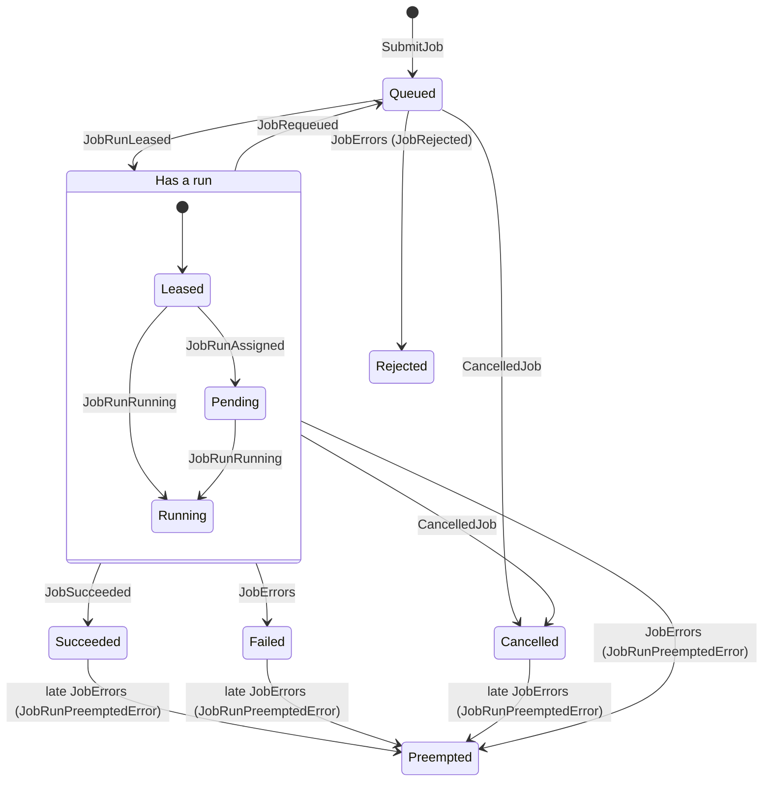

Lookout ignores updates to a terminal job, with one exception: `Preempted` can replace `Succeeded`, `Failed`, or `Cancelled`. A `Cancelled` job still accepts the cancel user and the cancel reason when these columns are empty. A `Preempted` job still accepts the name of the user who requested the preemption when that column is empty.

The executor reports only the current phase of a pod, so a job or run can skip `Pending` or `Running`. For example, the job goes from `Leased` to `Running` when the pod is already running at the first report.

### Run state

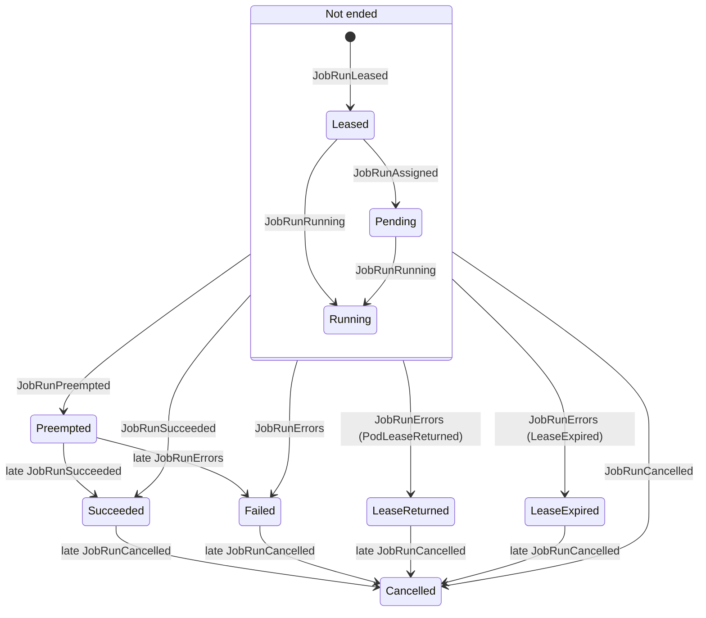

Lookout does not guard run rows. Each event overwrites the columns that it sets, so a late event can change an ended run. There are two late transitions:

- A pod can end before the executor deletes it for a preemption. The executor then reports `JobRunSucceeded` or `JobRunErrors`, and the run shows that outcome under a `Preempted` job.
- `JobRunCancelled` names the latest run of the job, also when that run has ended. A cancel request for a job whose latest run ended, but whose job is not terminal, changes that run to `Cancelled`.

### Run state in the executor

The executor keeps its own state for each run that it has. This state controls pod creation and cleanup. The executor sends the IDs of all its runs in each `LeaseRequest`. The scheduler does not send these runs again as new leases.

| Executor phase         | Set when                                                                        |
| ---------------------- | ------------------------------------------------------------------------------- |
| `Leased`               | the executor receives the lease                                                 |
| `Invalid`              | the executor cannot build a pod from the lease, and reports `PodError`          |
| `SuccessfulSubmission` | the executor creates the pod through the Kubernetes API                         |
| `FailedSubmission`     | pod creation fails, and the executor reports the failure                        |
| `Active`               | the pod informer sees the pod, or the executor finds the pod at start-up        |

The executor removes a run from its state in these cases:

- The scheduler cancels the run. The scheduler cancels each listed run that is terminated in its database or unknown to it, for example after the executor reports a failure. The executor deletes the pod if it is still active. It removes the run when the pod is gone, or when the pod has ended and its phase is reported.
- The pod of a `SuccessfulSubmission` run does not appear within `deadlineForSubmittedPodConsideredMissing`. The executor emits no event. The run is no longer in the `LeaseRequest`, so the scheduler sends the same lease again.

When the pod of an `Active` run is missing for longer than `deadlineForActivePodConsideredMissing`, the executor reports `PodError`.

## Event reference

### Request events

Request events ask for a change. The server publishes them, the scheduler ingester writes them to the database, and the scheduler acts on them in a later cycle.

| Event                    | Emitted by          | Carries                 |
| ------------------------ | ------------------- | ----------------------- |
| `SubmitJob`              | server              | job spec                |
| `CancelJob`              | server or scheduler | job ID, optional reason |
| `CancelJobSet`           | server              | job states, reason      |
| `JobPreemptionRequested` | server              | job ID, reason          |
| `ReprioritiseJob`        | server              | job ID, priority        |
| `ReprioritiseJobSet`     | server              | priority                |

The scheduler emits `CancelJob` for each job of a [cancelled job set](#job-set-and-control-plane-cancellation).

### Run-level events

Run-level events describe what happened to one run.

| Event                       | Emitted by            | Carries                                                                  |
| --------------------------- | --------------------- | ------------------------------------------------------------------------ |
| `JobRunLeased`              | scheduler             | executor ID, node ID, pool, scheduling priority, pod spec changes, queued version |
| `JobRunAssigned`            | executor              | pod identity, pod number, pool                                           |
| `JobRunRunning`             | executor              | pod identity, node name, pod number, pool, start-up info                 |
| `JobRunSucceeded`           | executor              | pod identity, node name, pod number                                      |
| `JobRunErrors`              | executor or scheduler | one or more [`Error` values](#error-values)                              |
| `JobRunPreempted`           | scheduler             | preempted run ID, preempted job ID, preempting job ID, reason, requestor |
| `JobRunCancelled`           | scheduler             | run ID, job ID, cancel reason, requestor                                 |
| `JobRunTerminatedDebugInfo` | executor              | run ID, job ID, debug message                                            |
| `StandaloneIngressInfo`     | executor              | pod identity, ingress addresses                                          |
| `ResourceUtilisation`       | executor              | pod identity, resource usage                                             |

### Job-level events

Job-level events come from the scheduler. They give the outcome of the job. A job outcome usually comes one cycle after the run-level event reaches the database.

| Event              | Emitted by | Carries                                         |
| ------------------ | ---------- | ----------------------------------------------- |
| `JobValidated`     | scheduler  | job ID, pools                                   |
| `JobSucceeded`     | scheduler  | job ID                                          |
| `JobErrors`        | scheduler  | one or more [`Error` values](#error-values)     |
| `JobRequeued`      | scheduler  | job ID, updated scheduling info, queued version |
| `CancelledJob`     | scheduler  | job ID, cancel user                             |
| `ReprioritisedJob` | scheduler  | job ID, priority, requestor                     |

The scheduler publisher also emits `PartitionMarker`. When an instance becomes the leader, it sends one marker to each Pulsar partition, and waits until the scheduler ingester writes all of them. Then the database contains every event that was published before the markers. It is not part of the job lifecycle.

### Error values

`JobRunErrors` and `JobErrors` carry `Error` values with these fields:

- `terminal`: true when Armada stops work on the run or the job.
- `reason`: the components emit one of `PodError`, `PodLeaseReturned`, `LeaseExpired`, `MaxRunsExceeded`, `JobRunPreemptedError`, `JobRejected`, or `ReconciliationError`.
- `failure_category` and `failure_subcategory`: the classification of the failure.
- `retry_policy_name`: the retry policy that decided the retry or the terminal failure.

Preemption errors use the category `preemption`. The subcategory is the preemption type: `fairshare`, `urgency`, `optimiser`, `api`, `reconciler`, `unknown`, or `unknown-gang`.

### Events that watchers receive

Watchers receive external API events. The event ingester writes a filtered copy of the internal events to Redis, and the server converts them when a watcher reads them. The event ingester removes these items:

- the `Groups` field of each event sequence
- `JobRunSucceeded`, `JobValidated`, and `JobRunTerminatedDebugInfo`
- `JobRunErrors`, except for the `LeaseExpired` and `PodLeaseReturned` reasons
- cancel reasons, start-up info, and debug messages

| Internal event              | External event                                    | Notes                                                                    |
| --------------------------- | ------------------------------------------------- | ------------------------------------------------------------------------ |
| `SubmitJob`                 | `JobSubmittedEvent` and `JobQueuedEvent`          |                                                                          |
| `JobRunLeased`              | `JobLeasedEvent`                                  |                                                                          |
| `JobRunAssigned`            | `JobPendingEvent`                                 |                                                                          |
| `JobRunRunning`             | `JobRunningEvent`                                 |                                                                          |
| `JobSucceeded`              | `JobSucceededEvent`                               |                                                                          |
| `JobErrors`                 | `JobFailedEvent`                                  | Carries the reason and the category. `Retryable` is true for a non-terminal error. |
| `CancelJob`                 | `JobCancellingEvent`                              |                                                                          |
| `CancelledJob`              | `JobCancelledEvent`                               |                                                                          |
| `JobPreemptionRequested`    | `JobPreemptingEvent`                              |                                                                          |
| `JobRunPreempted`           | `JobPreemptedEvent`                               |                                                                          |
| `ReprioritiseJob`           | `JobReprioritizingEvent`                          |                                                                          |
| `ReprioritisedJob`          | `JobReprioritizedEvent`                           |                                                                          |
| `ResourceUtilisation`       | `JobUtilisationEvent`                             |                                                                          |
| `StandaloneIngressInfo`     | `JobIngressInfoEvent`                             |                                                                          |
| `JobRunErrors`              | `JobLeaseReturnedEvent` or `JobLeaseExpiredEvent` | For the `PodLeaseReturned` and `LeaseExpired` reasons only.              |
| `JobRunSucceeded`           | (none)                                            | Watchers use `JobSucceededEvent`.                                        |
| `JobRunCancelled`           | (none)                                            | Watchers use `JobCancelledEvent`.                                        |
| `JobRequeued`               | (none)                                            | Watchers see the next `JobLeasedEvent`.                                  |
| `CancelJobSet`              | (none)                                            | Watchers see one `JobCancellingEvent` for each job.                      |
| `JobRunTerminatedDebugInfo` | (none)                                            | Only Lookout stores this event.                                          |
| `JobValidated`              | (none)                                            |                                                                          |
| `ReprioritiseJobSet`        | (none)                                            |                                                                          |

Watchers see the outcome of a job only when the scheduler emits the job-level event. Lookout updates the run state from the run-level events. It sets the job state to `Leased`, `Pending`, or `Running` from `JobRunLeased`, `JobRunAssigned`, and `JobRunRunning`, and sets `Queued` and the terminal job states from the job-level events.

## Job failed

A run can fail in three ways: the pod fails, the issue handler finds a problem with the pod, or the executor or the scheduler finds a problem without a pod. In each case, the scheduler then decides whether to [retry the job](#retry-and-requeue) or to fail it.

### The pod fails

The container exits with a non-zero code, or Kubernetes evicts the pod. The state reporter classifies the failed pod. If a failed-pod check matches, or the category has the `Delete` action, the state reporter gives the pod to the [issue handler](#the-issue-handler-finds-a-problem). Otherwise, it reports `JobRunErrors` with `PodError`.

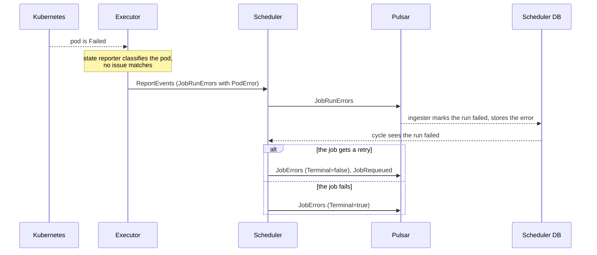

- **Run state:** `Failed`. A pod that fails quickly can go from `Pending` to `Failed`.
- **Job state:** `Failed`, or `Queued` when the job gets a retry.
- **Watchers:** `JobFailedEvent`. For a retry, `Retryable` is true, and the next event is `JobLeasedEvent`.

The terminal `JobErrors` copies the error of the run. When a retry policy decides the failure, the reason is `MaxRunsExceeded`, and the message includes the run error.

### The issue handler finds a problem

The issue handler finds the pods that the state reporter cannot report alone. It registers an issue in memory, and a periodic tick processes the issue.

| Issue type                 | Detected when                                                                             |
| -------------------------- | ----------------------------------------------------------------------------------------- |
| `UnableToSchedule`         | a `Pending` pod has no node after a deadline                                              |
| `StuckStartingUp`          | a pod check returns a retry or fail action                                                |
| `StuckTerminating`         | a pod that the executor did not mark for deletion stays in deletion past `stuckTerminatingPodExpiry` |
| `ActiveDeadlineExceeded`   | a pod runs longer than its `activeDeadlineSeconds`, plus its termination grace period, plus `stuckTerminatingPodExpiry` |
| `ExternallyDeleted`        | a pod disappears, the executor did not mark it for deletion, and its terminal phase is not reported |
| `ErrorDuringIssueHandling` | a pod starts after the handler requested its deletion                                     |
| `FailedStartingUp`         | a failed pod matches a retryable failed-pod check                                         |
| `DeleteActionFailure`      | a failed pod matches a category with the `Delete` action                                  |

The issue type sets the order of the report and the deletion:

- **Non-retryable issue:** the handler reports `PodError`, and then deletes the pod.
- **Retryable issue:** the handler deletes the pod, and reports `PodLeaseReturned` when the pod is gone. See [Retry and requeue](#retry-and-requeue).
- **`DeleteActionFailure`:** the handler deletes the pod, and reports `PodError` when the pod is gone. If the pod is still present after `stuckTerminatingPodExpiry`, the handler reports an internal failure.

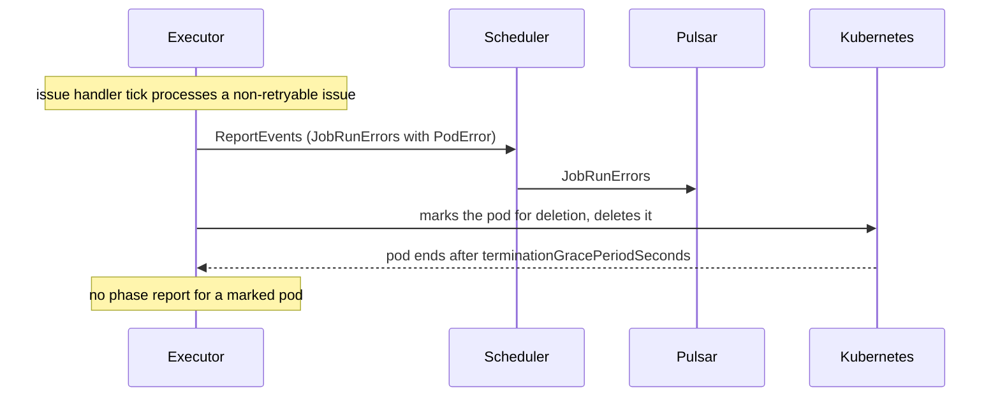

After the report, the scheduler concludes the job as in [The pod fails](#the-pod-fails). The event carries the message and the category of the issue. For why the pod phase is not reported, see [Pod deletion and debug events](#pod-deletion-and-debug-events).

### Other failure sources

| Source                      | Trigger                                                                             | Event                                                     |
| --------------------------- | ----------------------------------------------------------------------------------- | --------------------------------------------------------- |
| executor job requester      | the executor cannot build a pod from the lease                                      | `JobRunErrors` with `PodError`                            |
| executor cluster allocation | pod creation fails with a recoverable error                                         | `JobRunErrors` with `PodLeaseReturned`                    |
| executor cluster allocation | pod creation fails with a fatal error                                               | `JobRunErrors` with `PodError`                            |
| executor issue handler      | the pod of an active run stays missing past `deadlineForActivePodConsideredMissing` | `JobRunErrors` with `PodError`                            |
| scheduler                   | [lease expiry](#lease-expiry)                                                       | `JobRunErrors` and `JobErrors` in one cycle               |
| scheduler                   | [run reconciliation](#run-reconciliation) of a non-preemptible job                  | `JobRunErrors` and `JobErrors` with `ReconciliationError` |
| scheduler                   | [job rejection](#job-rejected)                                                      | `JobErrors`                                               |

## Retry and requeue

When the latest run of a job fails, the scheduler decides on the next cycle whether to requeue the job. Two mechanisms can grant a retry:

- **Lease return.** The executor returns the lease when the pod cannot start, or when pod creation fails with a recoverable error. The run shows `LeaseReturned`.
- **Retry policy.** When `retryPolicy.enabled` is true, the retry policy of the queue (or the default policy) decides a categorised pod failure. Retry policies do not decide lease returns, gang jobs, or jobs with the `armadaproject.io/failFast` annotation.

The scheduler applies these checks in order:

1. **Lease return.** The job gets a retry when the run returned its lease, the job does not have `failFast` set to `true`, and the attempt count is below `scheduling.maxRetries` plus 1. Runs count as attempts when `run_attempted` is true. A recoverable pod-creation failure counts as an attempt, and an `UnableToSchedule` issue does not count.
2. **Retry policy.** If a retry policy decides the failure, its decision replaces the result of the first check.
3. **Memory increase.** If the matching rule of the policy adds memory, the scheduler grows the job. If the larger job fits no node, the job fails.
4. **Node anti-affinity.** For an attempted run, the scheduler adds node anti-affinity for each node that the job failed on. A lease-return retry always gets it, and a policy retry gets it when the rule sets `avoidSameNode`. If no other node fits, the job fails.

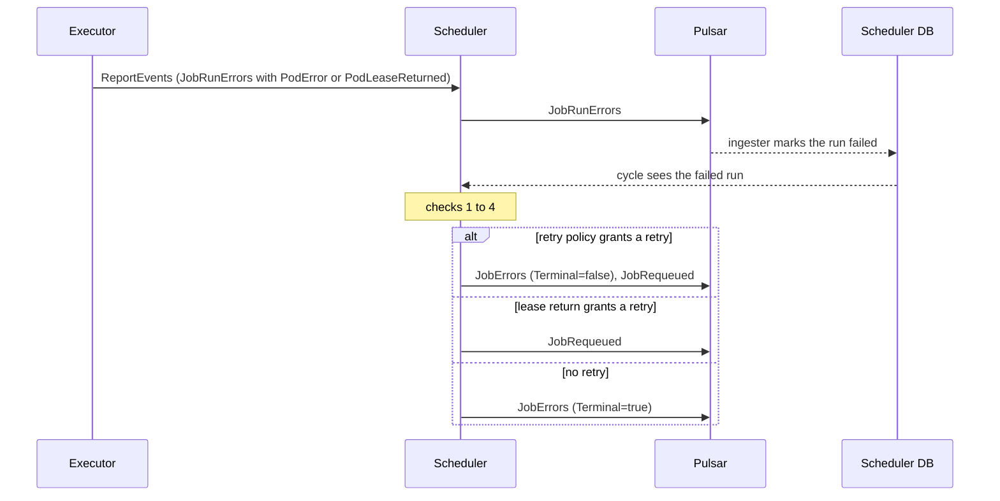

The events depend on the result:

| Result                     | Events                                                   |
| -------------------------- | -------------------------------------------------------- |
| policy retry               | `JobErrors` (Terminal=false, policy name), `JobRequeued` |
| lease-return retry         | `JobRequeued`                                            |
| a check stops the retry    | `JobErrors` (`MaxRunsExceeded`, Terminal=true)           |
| no retry for a pod failure | `JobErrors` with the run error, Terminal=true            |

`JobRequeued` sets `queued=true` and carries the updated scheduling info. The next lease includes the memory change and the anti-affinity. Watchers receive `JobLeaseReturnedEvent` for a lease return, and then `JobLeasedEvent` for the next run or `JobFailedEvent`.

## Lease expiry

An executor is stale when its last heartbeat is older than `executorTimeout`. The scheduler checks for stale executors on every cycle. It acts on each job that is not queued and not terminal, and whose latest run is on a stale executor. It emits the run-level and job-level events in the same cycle.

- **Run state:** `LeaseExpired`, or `Failed` when a retry policy declines a retry.
- **Job state:** `Failed` by default.

| Case                  | Events                                                                       | Watchers receive                                                         |
| --------------------- | ---------------------------------------------------------------------------- | ------------------------------------------------------------------------ |
| default               | `JobRunErrors` and `JobErrors`, with `LeaseExpired`, Terminal=true           | `JobLeaseExpiredEvent`, `JobFailedEvent`                                 |
| retry policy retries  | `JobRunErrors` (`LeaseExpired`), `JobErrors` (Terminal=false), `JobRequeued` | `JobLeaseExpiredEvent`, `JobFailedEvent` (`Retryable`), `JobLeasedEvent` |
| retry policy declines | `JobRunErrors` and `JobErrors`, with `MaxRunsExceeded`, Terminal=true        | `JobFailedEvent`                                                         |

If the executor connects again, the scheduler tells it to cancel the run.

## Job preempted

Three mechanisms preempt a job: a scheduling round, a request through the API or the control plane, and run reconciliation. All three emit the same events through `createEventsForPreemptedJob`:

| Event             | Payload                                                                  |
| ----------------- | ------------------------------------------------------------------------ |
| `JobRunPreempted` | preempted run ID, preempted job ID, preempting job ID, reason, requestor |
| `JobRunErrors`    | Terminal=true, `JobRunPreemptedError`, category, subcategory             |
| `JobErrors`       | Terminal=true, `JobRunPreemptedError`, category, subcategory             |

- **Run state:** `Preempted`.
- **Job state:** `Preempted`.
- **Watchers:** `JobPreemptedEvent` and `JobFailedEvent`.

### Preemption by the scheduler

A scheduling round decides to preempt a run, for example to give its resources to a job with a higher priority or a larger fair share. The scheduler emits the events in the same cycle.

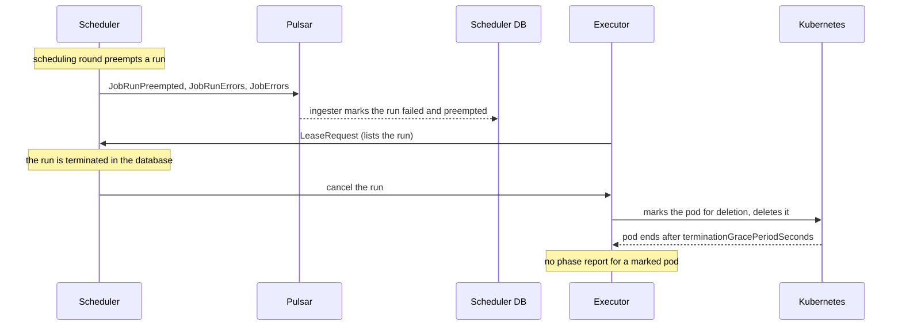

The scheduler ingester marks the run failed, so the database column `runs.terminated` becomes true. On the next `LeaseRequest`, the scheduler sends the runs that the executor has and that are terminated in the database. The executor then deletes the pods of those runs. See [Pod deletion and debug events](#pod-deletion-and-debug-events).

### Preemption on request

A user requests preemption through `PreemptJobs`. An operator requests it for all jobs on an executor, a node, or a queue through `PreemptOnExecutor`, `PreemptOnNode`, or `PreemptOnQueue`. `PreemptJobs` publishes `JobPreemptionRequested`. The operator calls publish control-plane events, which the scheduler ingester reads from a separate Pulsar topic. Each request sets `preempt_requested` on the runs of the job that are not terminated.

On the next cycle, the scheduler preempts each preemptible job with a requested preemption and an active run. It uses the preemption type `api`. The pod deletion then follows [Preemption by the scheduler](#preemption-by-the-scheduler).

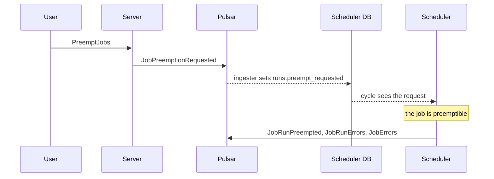

Watchers receive `JobPreemptingEvent` when the server publishes `JobPreemptionRequested`. Lookout stores the name of the user who requested the preemption.

### Run reconciliation

The per-pool `ExperimentalRunReconciliation` setting enables this mechanism. In a scheduling round, `RunNodeReconciler` marks a leased run as invalid in these cases:

- No executor reports the node of the run, and the job is in a gang.
- The node is in a pool that is not the pool of the run or one of its away pools.
- The job does not match the reservation of the node (`EnsureReservationMatch`).
- The job matches the reservation of the node (`EnsureReservationDoesNotMatch`).

For a preemptible job, the reconciler emits the preemption events with the type `reconciler`. It also preempts the other preemptible members of the gang. For a non-preemptible job, it emits `JobRunErrors` and `JobErrors` with the `ReconciliationError` reason.

When a node is deleted, the executor also finds the missing pod and emits `JobRunErrors` with `PodError` (`ExternallyDeleted`). The result depends on which event reaches the database first:

- If the executor error is first, the job is already terminal. The reconciler skips the job, and the run ends as `Failed`.
- If the scheduling round is first, two producers write to the same run. The later write sets the error and the end time of the run, in the scheduler database and in Lookout. Watchers receive one `JobPreemptedEvent`.

## Job cancelled

A user cancels a job through `CancelJobs`. The server publishes `CancelJob`, and the scheduler ingester sets `cancel_requested` on the job. On the next cycle, the scheduler emits the cancel events.

| Event             | Emitted by | Payload                                         |
| ----------------- | ---------- | ----------------------------------------------- |
| `CancelJob`       | server     | job ID, cancel reason                           |
| `JobRunCancelled` | scheduler  | latest run ID, job ID, cancel reason, requestor |
| `CancelledJob`    | scheduler  | job ID, cancel user                             |

- **Run state:** `Cancelled`.
- **Job state:** `Cancelled`.
- **Watchers:** `JobCancellingEvent` and `JobCancelledEvent`.

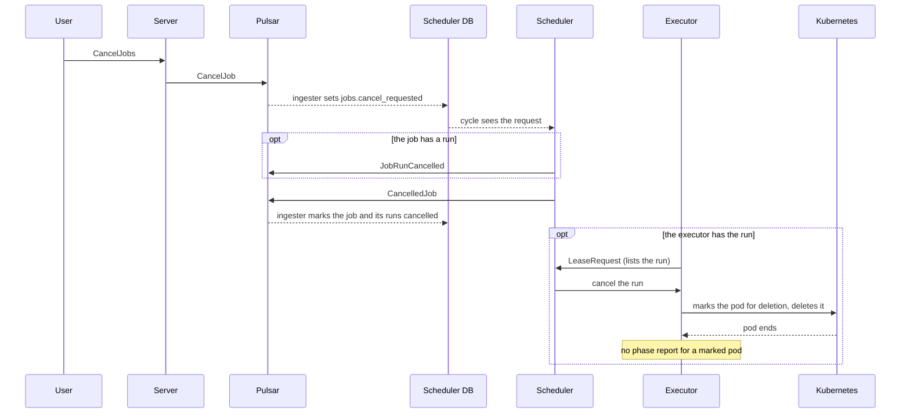

The scheduler checks cancel requests before run outcomes in the same cycle. A job with a succeeded run and a cancel request ends as `Cancelled`, and the scheduler emits no `JobSucceeded`.

`JobRunCancelled` names the latest run of the job, also when that run has ended. Lookout then shows that run as `Cancelled`. The scheduler ingester ignores `JobRunCancelled`. When it processes `CancelledJob`, it marks every run of the job cancelled, including earlier runs.

The cancel reason is on the `CancelJob` from the server, on `CancelJobSet`, and on `JobRunCancelled`. Lookout stores it on the run. The executor deletes the pod as described in [Pod deletion and debug events](#pod-deletion-and-debug-events).

### Job-set and control-plane cancellation

A user cancels a job set through `CancelJobSet`, optionally only for jobs in given states. The server publishes `CancelJobSet`, and the scheduler ingester sets `cancel_by_jobset_requested` on the matching jobs. For each job, the scheduler then emits `CancelJob`, `JobRunCancelled` if the job has a run, and `CancelledJob`. The `CancelJob` gives watchers a `JobCancellingEvent` for each job.

An operator cancels all jobs on an executor, a node, or a queue through `CancelOnExecutor`, `CancelOnNode`, or `CancelOnQueue`. These control-plane events set `cancel_requested` on the matching jobs. The flow then continues as for a single job.

## Job reprioritised

A user changes the priority of jobs through `ReprioritizeJobs`. The request names jobs or a whole job set.

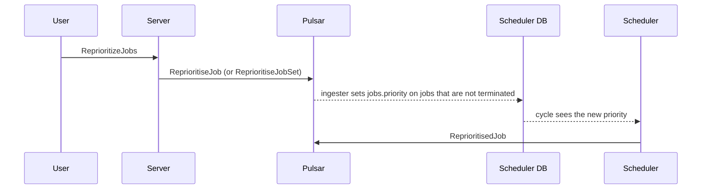

1. The server publishes `ReprioritiseJob` for each named job, or one `ReprioritiseJobSet` for a job set.
2. The scheduler ingester writes the new priority and the user on each job that is not terminated.
3. The scheduler sees that the priority in the database differs from the priority in `jobdb`. It applies the new priority and emits `ReprioritisedJob`.
4. Lookout updates the priority of the job from `ReprioritisedJob`. Watchers receive `JobReprioritizingEvent` for each `ReprioritiseJob`, and `JobReprioritizedEvent`.

In a queue, the scheduler orders jobs of the same priority class by this priority, and a lower number comes first. The order applies to queued jobs, and to running jobs that the scheduler evicts and schedules again.

## Job rejected

The scheduler checks each job that it has not validated, on every cycle. It does not check jobs in cordoned queues. It rejects a job in these cases:

- The submit check finds no node in any pool that can run the job.
- The resource requests of the job are not valid.
- The gang of the job is not valid.

For a rejected job, the scheduler emits `JobErrors` with the `JobRejected` reason and Terminal=true. The scheduler ingester marks the job failed.

- **Run state:** the job has no run.
- **Job state:** `Queued` to `Rejected`. Lookout stores the message.
- **Watchers:** `JobFailedEvent` with the `Rejected` cause.

## Delivery, retries, and duplicates

Events can arrive late or more than once. This section describes how each component handles a failure, and where a watcher can see a duplicate.

### Executor reports

The state reporter puts events in a buffer with 1,000,000 slots. It sends the buffer every two seconds, or earlier when a batch is full. The event sender compacts each batch and splits it by message size. The issue handler, the pod-creation code, and the run processors call `Report` directly.

Two mechanisms send a failed report again:

- **State reporter.** A reconciliation pass runs at the interval `task.missingJobEventReconciliationInterval`. It selects pods that are in their phase for at least 30 seconds, whose phase is not reported, and that have no queued events. It skips the `Pending` and `Unknown` phases, so a lost `JobRunAssigned` is not sent again.
- **Issue handler.** The handler sets a `Reported` marker in memory after a successful `Report` call. The next tick sends a failed report again. The executor loses this marker when it restarts.

### Pulsar redelivery

Pulsar can deliver an event more than once.

- **Scheduler database.** A second write has no effect. `MarkRunsSucceeded`, `MarkRunsFailed`, and `MarkRunsPreempted` take their times from the `Created` field of the event, and a redelivered event has the same value. The scheduler ingester upserts `job_run_errors` on `run_id`.
- **Redis.** The event ingester adds each event to the Redis stream with an automatic ID, so a redelivery adds a second entry. A watcher can see the same external event twice.

### Events that the scheduler generates again

The scheduler generates its events again in two cases:

- **Publish failure.** The scheduler does not advance its read position, so the next cycle generates the events again. The job-level events have a new `Created` value.
- **New leader.** In the first cycle after an instance becomes the leader, it generates events for all jobs, not only for the jobs that changed.

## Pod deletion and debug events

The `deletion_requested` annotation tells phase reporting that Armada is deleting a pod. Its presence suppresses ordinary phase-change events, so shutdown caused by cancellation does not become a second application failure.

| What happens | Marker and reporting |
| --- | --- |
| The live pod fails the deletion condition | No new marker is written; normal reporting remains eligible. |
| DELETE is definitely rejected | Remove this attempt's recoverable marker if no other attempt took it over and deletion has not started. |
| An updated executor takes over cancellation, or the API outcome is uncertain | Keep the marker and reporting suppression. |

Removing the marker does not replay a phase change that was suppressed while it was present: the marker-only update leaves the phase unchanged. The periodic missing-event reconciler can report the current phase if the pod remains available; it cannot reconstruct every missed intermediate transition.

Each actual deletion attempt writes a new UUID token, even when the pod is already marked. That adds one PATCH for a previously marked cancellation or force-kill attempt. A conditional call that finds the live pod already marked and terminating before its kill deadline only performs the GET and returns. An unmarked terminating pod still gets a marker before success is returned, preserving phase-report suppression and preventing its deletion from being classified as unexpected.

Conditional deletion checks the live UID and condition before writing a token with a resourceVersion guard. Pessimistic DELETE uses that returned version; every DELETE also checks UID to avoid deleting a replacement pod with the same name. The conditional DELETE shares the ten-second deadline started by its live GET. A timeout retains suppression because deletion may have succeeded.

The `conditional:` prefix identifies a token that a later version-guarded attempt can safely replace. Other tokens, including cancellation and legacy markers, stay non-removable through later attempts. Cleanup checks UID, token, resourceVersion and deletionTimestamp; it retries conflicts at most three times and returns failures alongside the DELETE error.

### Compatibility during executor upgrades

The [executor chart](../../deployment/executor/templates/deployment.yaml) requests one replica but omits a rollout strategy; Kubernetes therefore uses RollingUpdate, which permits old/new overlap. The executor startup path does not use leader election.

An older executor can observe a marker and prepare cancellation without writing a new token. If a new executor then removes that marker after its own DELETE is rejected, the older executor's unconditional DELETE can still succeed. The resulting shutdown can produce ordinary failed-run reporting or unexpected-deletion diagnostics instead of being suppressed. This window exists during mixed-version upgrades and rollbacks; its frequency has not been measured. Cleanup is always active, with no configuration flag.

For already-cancelled jobs, scheduler cancellation/terminal-state checks take precedence over retry handling; a late error can still make Lookout attempt history inconsistent. This is based on source tracing, not a complete mixed-version end-to-end test, and is not a universal no-retry guarantee for other deletion paths. Avoid overlapping legacy executors and drain their outstanding deletion requests if strict reporting consistency during the transition is required. Once every overlapping executor renews ownership, the token/version guards protect cleanup against concurrent cancellation.

The executor emits one `JobRunTerminatedDebugInfo` event in two cases:

- The executor cancels a run, and the main container of the pod never started. The cancel list includes preempted runs, so this case covers preemption too.
- A pod that the executor marked for deletion is still present `kubernetes.podKillTimeout` after its deletion timestamp.

The `debugMessage` is a JSON document. It describes the pod, its node, and their recent Kubernetes events. `PodError.debugMessage` and `PodLeaseReturned.debugMessage` use the same format. The `application.debugEvents.enabled` setting enables this capture. Only Lookout stores these events.
